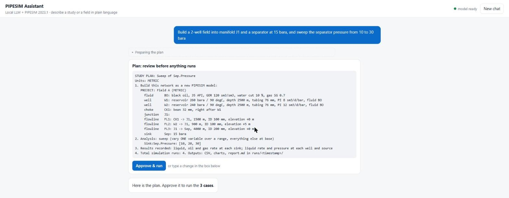

# PIPESIM Local Agent

A local AI assistant that operates SLB PIPESIM: it opens models, reads and changes parameters, runs
network and P/T profile simulations, and explains the results. Everything runs on your own PC.
No model data leaves the machine.

> **Reviewers wanted.** If you work with PIPESIM or multiphase flow, please read the
> [review guide](docs/REVIEW.md) (real results and validation, about 10 minutes) and leave an
> [expert review](https://github.com/shoshaqaibolma/pipesim-helper/issues/new?template=expert-review.yml).



```
 you (terminal)
      │
  agent.py ──HTTP──► llama-server (Qwen 3.5 9B GGUF, GPU)      ← local LLM, OpenAI-compatible API
      │
  pipesim_tools.py ──► sixgill (PIPESIM Python Toolkit) ──► PIPESIM engine / .pips model
      │
  mcp_server.py (optional) ──► same tools for Claude Desktop / LM Studio / other MCP clients
```

**New PC? Follow [`INSTALL.md`](INSTALL.md)** (setup.bat creates `config.bat` with your paths and checks everything).

## Quick start (already set up on this PC)
Double-click **`agent_ui.bat`** for the browser chat window (or `agent.bat` for the terminal).
Validation against the official case studies and engineering scenarios: [`docs/VALIDATION.md`](docs/VALIDATION.md).

In the terminal, `agent.bat` It starts the local model (Qwen 3.5 9B on the GPU) if needed, then the agent.
Describe what you want; answer its questions (or say "use defaults"); approve the plan; read the results.
Results, charts and a report go to `runs\<timestamp>\`; new models to `projects\`.

Example requests (all verified end to end on PIPESIM 2023.1 with the local model):
- "Build a field: two oil wells W1 and W2 into manifold J1, then a 5 km, 152 mm trunkline to a separator at
  15 bara. Black oil 35 API, GOR 100, 20% water cut. W1: 250 bara, 2500 m, PI 10. W2: 230 bara, 2400 m, PI 15.
  How does field oil change if the separator pressure goes from 10 to 30 bara?"
- "Build one gas-lifted well (..., gas lift at 2000 m with 0.05 MMsm3/d) and run a nodal analysis at 20 bara
  wellhead pressure. Then sweep the gas lift rate from 0 to 0.2 MMsm3/d and tell me the best rate."
- "We only have 0.15 MMsm3/d of lift gas: how should we split it between W1 and W2 to get the most oil?"
- "Open C:\...\my_model.pips and sweep the sink pressure from 10 to 40 bara." (works on a copy)

## 1. Prerequisites (Windows PC with PIPESIM)
- PIPESIM 2017.1 or later with a core license. The Python Toolkit is included with that license.
- An NVIDIA GPU with 8 GB of VRAM or more. Qwen 3.5 9B at Q4_K_M is about 6 GB and fits entirely on an 8 GB card.
- The Python environment that has `sixgill`. The PIPESIM installer ships the toolkit. Either use its bundled
  Python, or `pip install` the sixgill wheel from the PIPESIM install folder into your own venv.

## 2. Install
```bat
cd pipesim-agent
python -m pip install -r requirements.txt
python selftest.py "C:\path\to\some_model.pips"
```
The self-test needs no LLM. If it fails, the cause is a sixgill API difference in your PIPESIM version.
Adjust `pipesim_tools.py` using PIPESIM's Python Toolkit help, which has the exact signatures.

## 3. Start the local model
1. Download a CUDA build of llama.cpp: https://github.com/ggml-org/llama.cpp/releases
2. Download the Qwen 3.5 9B Q4_K_M GGUF (about 6 GB) from Unsloth's or Qwen's Hugging Face page.
   Fallback if tool calls come out malformed: Gemma 4 E4B (about 5 GB).
3. Set `LLAMA_DIR` and `MODEL_PATH` in `config.bat` (created by `setup.bat`) and run `start_llm.bat`.
   `--jinja` is required for tool calling.

## 4. Run
```bat
"D:\Program\Pipesim toolkit\python.exe" agent.py
```
Describe what you want in plain language. Two kinds of request:

**Studies** on an existing `.pips` model, or on a quick single-well model:

| Step | What happens | Who decides |
|---|---|---|
| Understand | Your request becomes a structured study spec (`study.py`) | LLM |
| Ask | A checker lists every required input you didn't give, with suggested defaults | **Code** (cannot be skipped) |
| Plan | A readable plan: model, cases, outputs, number of runs | You approve in chat |
| Run | `executor.py` runs every case. The LLM does not drive individual runs | You confirm `y` in the terminal |
| Analyze | CSV, charts and `report.md` in `runs/<timestamp>/`. The LLM explains the trends | LLM |

Analysis types: `single_run`, `sweep` (1 variable), `grid` (2-3 variables, full factorial),
`tornado` (low/high per variable, ranked), `pt_profile`. If no result changes across the cases, the report
says so (the varied input may be isolated by a pump or fixed-pressure node, or did not take effect).

**New projects** described in plain language, like the PIPESIM case studies:
- **Networks:** oil or gas wells (PI, Vogel or back-pressure IPR, optional gas lift), sources with a fixed pressure
  or flow rate, chokes, manifolds (junctions), two-phase separators with gas/liquid outlets, pumps and compressors
  (by discharge pressure, pressure rise, ratio or power), flowlines and sinks.
- **Pipelines:** a source with a fixed liquid or gas rate, flowlines and a delivery pressure; PIPESIM calculates
  the inlet pressure.
- **Fluids:** black oil (API, GOR, water cut, gas SG) or gas/condensate (gas SG, OGR, WGR).

The agent writes the project, the checker asks for every missing input per component (with suggested defaults;
"use defaults" fills them all) and validates the layout (every well reaches a sink, one outlet per well, separator
outlets named, one inlet per choke/pump/compressor). It then writes a new `.pips` file into `projects\`
(`build_project`, never overwrites) or runs studies on the network. Project units: bara, degC, m, mm, sm3/d, mmsm3/d.

**Nodal analysis** of a well at a given outlet pressure: operating point (rates, flowing bottom-hole pressure),
inflow/outflow curves and the IPR/VLP plot.

**Optimization** (`optimize`): tries every combination of 1-3 variables, such as each well's gas lift rate, that
respects an optional limit on their sum (the lift gas available), and reports the best case, the top five and a
ranked chart. Example: "we have 0.15 MMsm3/d of lift gas, how should we split it between W1 and W2?"

Results always come with units; percentage changes, best/worst cases and tornado rankings are computed by the code,
not the language model; networks with several sinks get field totals.

**Guards for a small model:**
- *Number check* (`numguard.py`): every number in a reply must come from a simulation result, the checker, the
  plan or your own message (or be a difference / % change between run results). If not, the model is asked once
  to rewrite; anything still unverified is flagged under the reply. Switch off with `PIPESIM_NUMBER_GUARD=0`.
- *Recipes* (`recipes.py`): a table "question -> study type" in the system prompt, and one or two short worked
  examples added to your message when it matches (manifold, pipeline, gas lift, nodal, tornado, grid, facility).
  Switch off with `PIPESIM_AGENT_KNOWLEDGE=0`.
- *Sanity checks*: likely unit mistakes (psi for bara, inch for mm, ft for m, scf/stb for sm3/sm3) are reported as
  warnings before the plan; impossible inputs (water cut over 100 %, elevation larger than the line length) block.

Terminal commands: `spec` shows the current spec and project, `reset` starts over.

## How the code is organised
- `agent.py`: chat loop and tools. `study.py` / `project.py`: what to ask, plan text.
- `executor.py`: runs studies. `netbuilder.py`: builds `.pips` models from a project. `builder.py`: templates.
- `sixgill_adapter.py`: **every PIPESIM-version-specific detail** (sixgill names, boundary conditions,
  connections). `tests/test_api_names.py` checks all names against `knowledge/api.json`, which
  `tools/introspect.py` records from the real install.

## Tests
- Offline (fake `sixgill`, scripted fake LLM; numbers mean nothing): every `tests/test_*.py`.
  `tests/test_agent_robustness.py` replays tool calls the local model really made.
- On the PC with PIPESIM (`tests/real_*.py`): builder smoke test, pipelines and gas wells, gas lift curve,
  nodal analysis, a CSN_301-style facility, and the full agent (`real_agent_test.py - tests\scripts\<script>.txt`).
- Before/after evaluation of the agent (8 scenarios, recipes and number check off vs on, scored automatically):
  `"D:\Program\Pipesim toolkit\python.exe" tests\real_eval.py` -> `knowledge\eval_summary.md`
- Real end-to-end test on the PC (PIPESIM, llama-server and the agent together; works on a temp copy of the model):
  `"D:\Program\Pipesim toolkit\python.exe" tests\real_agent_test.py "path\to\model.pips"`

## Tuning for a small local model
- Temperature is 0 and thinking is off for tool calls. Low-bit quantizations reason less well, so the
  tools are coarse-grained and return compact, downsampled JSON.
- If the model guesses parameter names, add the exact names your models use (from the Python Toolkit
  `Parameters` reference) to the system prompt in `agent.py`.
- Swapping models only needs a new GGUF. Any llama.cpp model with tool calling works,
  With 16-24 GB of VRAM, Qwen3.8-27B at Q4_K_M plans and reasons noticeably better.

## Using it from Claude or other MCP clients
Run `python mcp_server.py` (needs Python 3.10 or later and `pip install mcp`) and register it as a stdio MCP server.
