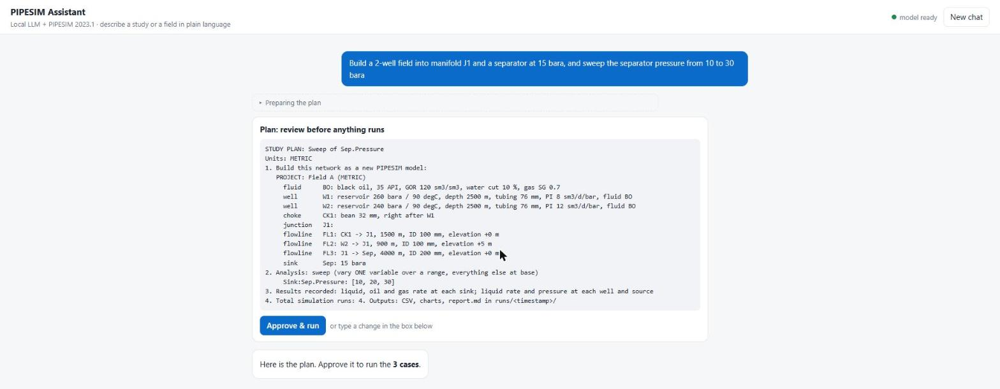
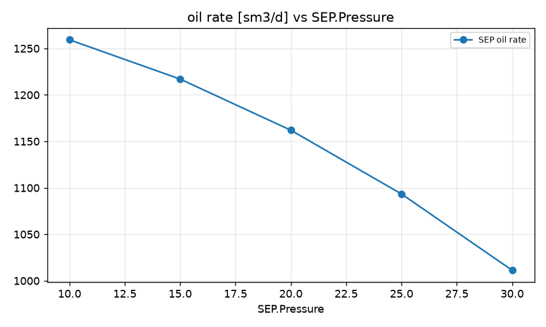
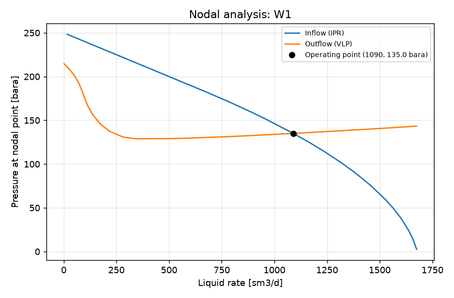
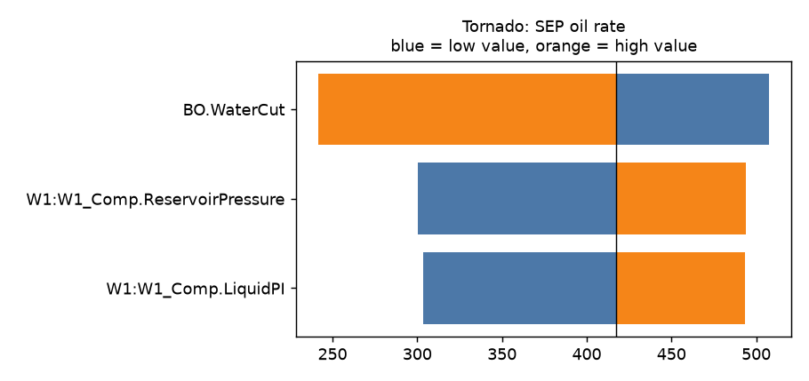

# Call for expert review

**PIPESIM Local Agent** is a research prototype. It is a local AI assistant that builds and runs SLB PIPESIM
studies from a plain-language description. I am looking for **production, flow assurance and reservoir engineers**
to judge whether its engineering is sound. A review takes about 15 minutes, and you do not need to install anything.

**How to review:** read this page, then open a
**[review issue](https://github.com/shoshaqaibolma/pipesim-helper/issues/new?template=expert-review.yml)** and
fill in the form. If you would rather not post publicly, contact the repository owner directly with the same
answers.

---

## What it does

An engineer describes a field or a question, for example:

> Build a field: two oil wells W1 and W2 flow through 1.5 km and 0.9 km, 100 mm flowlines into manifold J1, then a
> 5 km, 152 mm trunkline (10 m uphill) to a separator at 15 bara. Black oil 35 API, GOR 100 sm3/sm3, 20% water cut.
> W1: reservoir 250 bara, depth 2500 m, PI 10 sm3/d/bar. W2: 230 bara, 2400 m, PI 15. How does field oil change if
> the separator pressure goes from 10 to 30 bara?

A small language model (Qwen 3.5 9B) running on the engineer's own GPU turns the request into a PIPESIM model and
a study plan. The engineer approves the plan, PIPESIM 2023.1 runs every case through the Python Toolkit, and the
assistant explains the results. Model data never leaves the PC.

The browser interface with a plan waiting for approval. The screenshot was taken with the test fakes, so the
values are placeholders.

### Who decides what

| Step | What happens | Who decides |
|---|---|---|
| Understand | The request becomes a project (wells, fluids, flowlines, separators) and a study spec | Language model |
| Ask | A checker lists every missing input per component, with suggested defaults. Unit slips (psi for bara, inch for mm) are flagged | Code |
| Plan | A readable plan: model, cases, outputs, number of runs | **Engineer approves** |
| Run | Every case runs in PIPESIM, on a new model or on a copy | Code |
| Explain | CSV, charts and a report. Every number in the reply must appear in the results, or the reply is rewritten | Language model + number check |

The language model never computes a result. The results tables, percentage changes, best cases and tornado rankings
are computed by code.

**Supported today:** oil and gas wells (PI, Vogel, back-pressure IPR, gas lift), chokes, manifolds, two-phase
separators, pumps, compressors and pipelines. Black-oil or gas/condensate fluids. Studies: single run, sweep, grid
(2-3 variables), tornado, P/T profile, nodal analysis, and constrained optimization (for example, splitting lift gas
between wells).

---

## Results from real PIPESIM runs

All charts below come from PIPESIM 2023.1 runs started from plain-language requests (Nov 2026).

**Separator pressure sweep** for the two-well field above:

| Separator [bara] | Field oil [sm3/d] | Field liquid [sm3/d] | Oil vs base (15 bara) |
|---|---|---|---|
| 10 | 1259 | 1574 | +3.5 % |
| 15 | 1217 | 1521 | 0 |
| 20 | 1162 | 1453 | −4.5 % |
| 25 | 1093 | 1367 | −10.2 % |
| 30 | 1011 | 1264 | −16.9 % |

Gas SG 0.7, reservoir temperature 90 degC and 76 mm tubing were not in the request. They are the checker's
suggested defaults, which the engineer accepts ("use defaults") or overrides, and they are shown in the plan before
anything runs.

**Nodal analysis** of a single well (reservoir 250 bara, PI 10 sm3/d/bar, 2500 m, 76 mm tubing) at 20 bara wellhead
pressure. The operating point is 1090 sm3/d of liquid at a flowing bottom-hole pressure of 135 bara.

**Uncertainty ranking (tornado)** of one well's oil rate (base 417 sm3/d). The oil swing is 266 sm3/d for water cut
(20 to 50 %), 193 sm3/d for reservoir pressure (200 to 250 bara) and 190 sm3/d for PI (6 to 14 sm3/d/bar).

---

## Validation

Full details are in [VALIDATION.md](VALIDATION.md).

**Models rebuilt from a short description vs the official training case studies.** Each case study was opened
and run, converted into the assistant's project description, rebuilt by the assistant and run under the same
conditions. The "detailed inputs" column also copies roughness, wall thickness and full black-oil settings. The last
column adds the heat-transfer and fluid thermal data read from the original `.pips` file.

| Case study | Quantity | From description | + detailed inputs | + thermal data |
|---|---|---|---|---|
| TF_M2B gas pipeline (P/T profile) | gas rate | +4.8 % | −1.6 % | **0.00 %** (outlet −0.51 degC, exact) |
| TF_M2C multiphase pipeline (P/T profile) | pressure loss | −6.9 % | −1.4 % | **+0.01 %** (outlet 20.21 degC, exact) |
| TF_M2A water pipeline (P/T profile) | pressure loss | −7.0 % | −3.4 % | −3.4 % (open) |
| TF_M3A oil well (nodal, 20 bara outlet) | liquid rate | +27 % | +27 % | not closed |

**The language model on eight scripted engineering conversations.** The scenarios are a field separator sweep, a
gas-lifted well (nodal analysis and lift sweep), lift gas allocation, a tornado, debottlenecking, sizing a 25 km gas
line, choke sizing and rising water cut. The "knowledge layer" (worked recipes plus the number check) is the
shipped default.

| | Plain model | Knowledge layer |
|---|---|---|
| Correct engineering answer | 8 / 8 | 8 / 8 |
| Checker errors the model had to fix | 13 | 0 |
| Tool calls | 93 | 62 |
| Invented numbers in result replies | 7, all reached the user | 1, removed before the user saw it |

---

## Open questions where your judgment helps most

1. **Well model, 27 % gap.** The rebuilt training well (TF_M3A) produces 27 % more liquid than the original.
   Copying the fluid, trajectory, geothermal and well settings did not change that. The suspected cause is the
   vertical multiphase flow correlation: the 2023.1 Python Toolkit does not expose it, so new models use PIPESIM's
   default. Does that match your experience? Which correlation would you expect the training case to use?
2. **Water line, 3.4 %.** The original uses PIPESIM's built-in "Water" fluid template, and the rebuild uses black
   oil at 100 % water cut. Is that enough to explain a 3.4 % pressure-loss gap?
3. **Defaults.** When an input is missing, the assistant suggests defaults (gas SG 0.7, 90 degC reservoir, 76 mm
   tubing, standard black-oil thermal data). Which would you change, and which inputs should it never assume?
4. **Scope.** What would you need next before using it for real screening work?

---

## Want to run it yourself?

You need a Windows PC with PIPESIM 2017.1 or later (a core license includes the Python Toolkit) and an NVIDIA GPU
with 8 GB of VRAM. See [INSTALL.md](../INSTALL.md). The offline tests (`tests/test_*.py`) run without PIPESIM or a
GPU, using a fake toolkit and a scripted model.
