STUDY PLAN: Analyze how total liquid rate changes with sink pressure sweep
Units: METRIC
1. Open a COPY of C:\Users\Home\AppData\Local\Temp\pipesim_agenttest_v6fdbch4\CSN_301_Small Network.pips (the original is not modified)
2. Analysis: sweep (vary ONE variable over a range, everything else at base)
     Sink:Oil-Facility.Pressure: [10, 20, 30, 40]
3. Results recorded: VOLUME_FLOWRATE_LIQUID_STOCKTANK @ (each producer), VOLUME_FLOWRATE_OIL_STOCKTANK @ (each producer), VOLUME_FLOWRATE_GAS_STOCKTANK @ (each producer), PRESSURE @ (each producer)
4. Total simulation runs: 5. Outputs: CSV, charts, report.md in runs/<timestamp>/

## Results

| case | Oil-Facility.Pressure | Well VOLUME_FLOWRATE_LIQUID_STOCKTANK | Well VOLUME_FLOWRATE_OIL_STOCKTANK | Well VOLUME_FLOWRATE_GAS_STOCKTANK | Well PRESSURE | Source VOLUME_FLOWRATE_LIQUID_STOCKTANK | Source VOLUME_FLOWRATE_OIL_STOCKTANK | Source VOLUME_FLOWRATE_GAS_STOCKTANK | Source PRESSURE | Well:Source 1 VOLUME_FLOWRATE_LIQUID_STOCKTANK | Well:Source 1 VOLUME_FLOWRATE_OIL_STOCKTANK | Well:Source 1 VOLUME_FLOWRATE_GAS_STOCKTANK | Well:Source 1 PRESSURE | Well:WellString outlet10269 VOLUME_FLOWRATE_LIQUID_STOCKTANK | Well:WellString outlet10269 VOLUME_FLOWRATE_OIL_STOCKTANK | Well:WellString outlet10269 VOLUME_FLOWRATE_GAS_STOCKTANK | Well:WellString outlet10269 PRESSURE | Well:WellString outlet10271 VOLUME_FLOWRATE_LIQUID_STOCKTANK | Well:WellString outlet10271 VOLUME_FLOWRATE_OIL_STOCKTANK | Well:WellString outlet10271 VOLUME_FLOWRATE_GAS_STOCKTANK | Well:WellString outlet10271 PRESSURE | _status |
|---|---|---|---|---|---|---|---|---|---|---|---|---|---|---|---|---|---|---|---|---|---|---|
| base | 20.68 | 804.6 | 804.6 | 1.394 | 67.05 | 32.7 | 32.7 | 0.05663 | 46.7 |  |  |  |  |  |  |  |  |  |  |  |  | Completed |
| Oil-Facility.Pressure=10 | 10 | 804.6 | 804.6 | 1.394 | 67.05 | 32.7 | 32.7 | 0.05663 | 46.7 |  |  |  |  |  |  |  |  |  |  |  |  | Completed |
| Oil-Facility.Pressure=20 | 20 | 804.6 | 804.6 | 1.394 | 67.05 | 32.7 | 32.7 | 0.05663 | 46.7 |  |  |  |  |  |  |  |  |  |  |  |  | Completed |
| Oil-Facility.Pressure=30 | 30 | 804.6 | 804.6 | 1.394 | 67.05 | 32.7 | 32.7 | 0.05663 | 46.7 |  |  |  |  |  |  |  |  |  |  |  |  | Completed |
| Oil-Facility.Pressure=40 | 40 | 804.6 | 804.6 | 1.394 | 67.05 | 32.7 | 32.7 | 0.05663 | 46.7 |  |  |  |  |  |  |  |  |  |  |  |  | Completed |

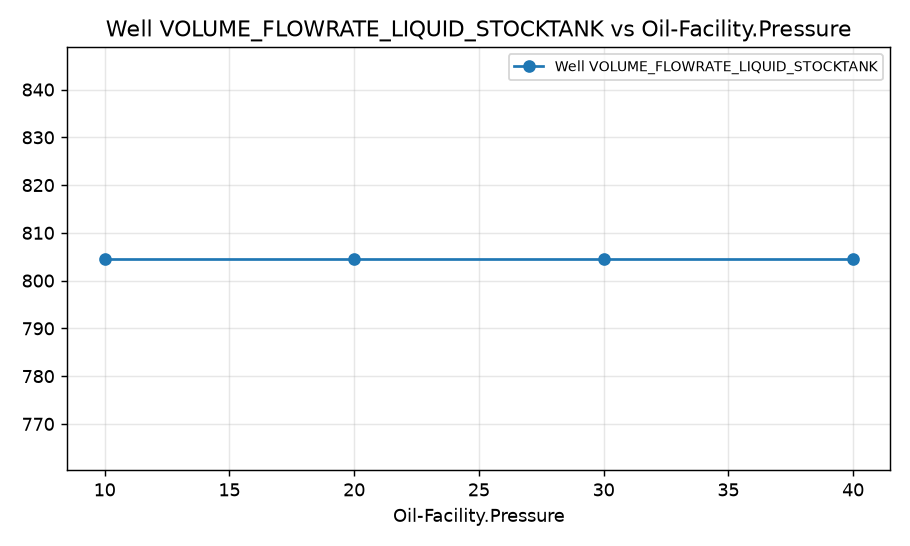

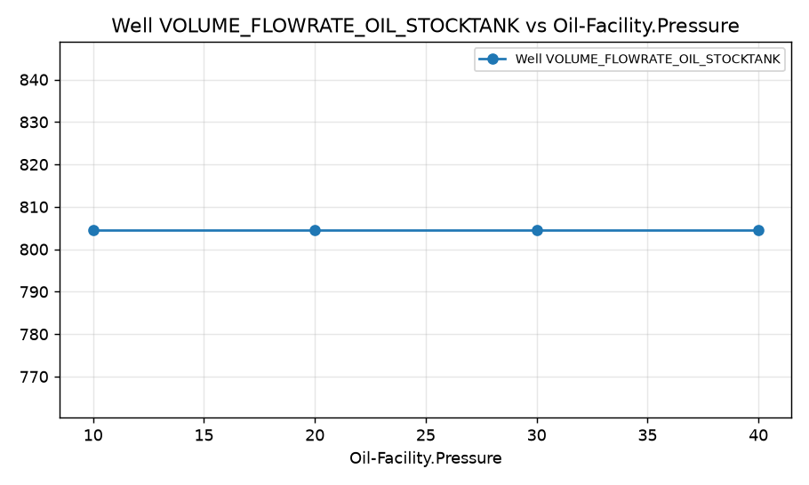

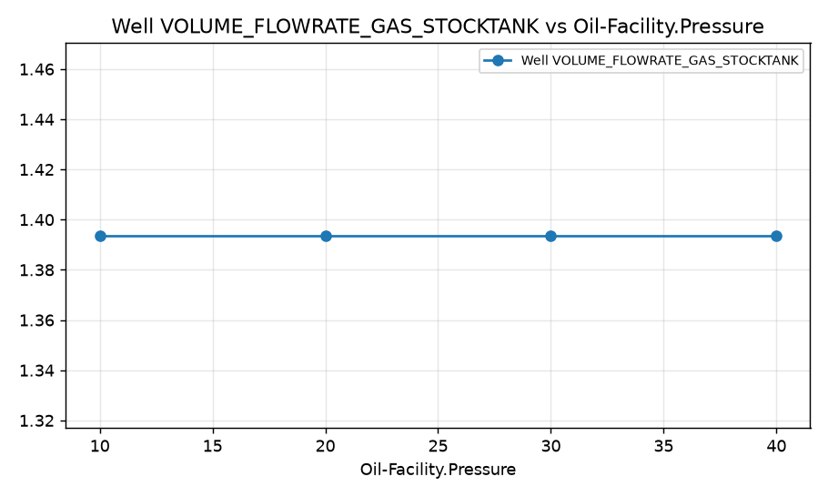

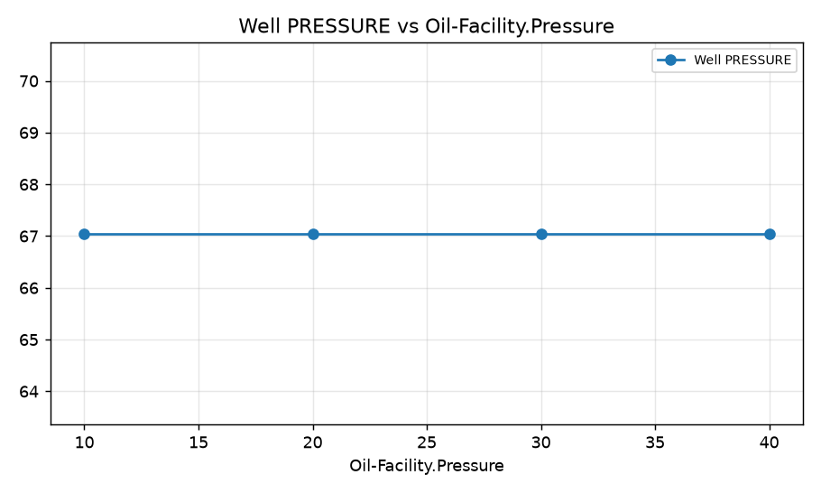

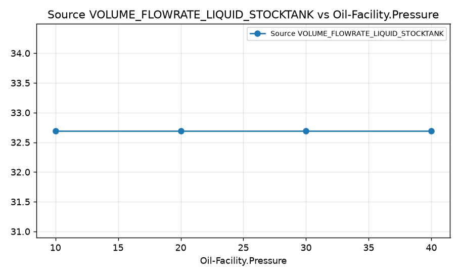

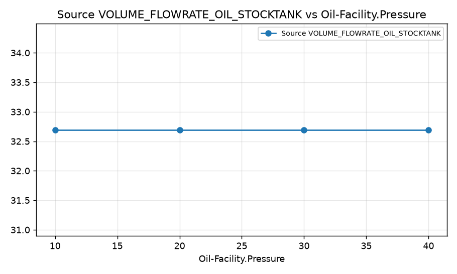

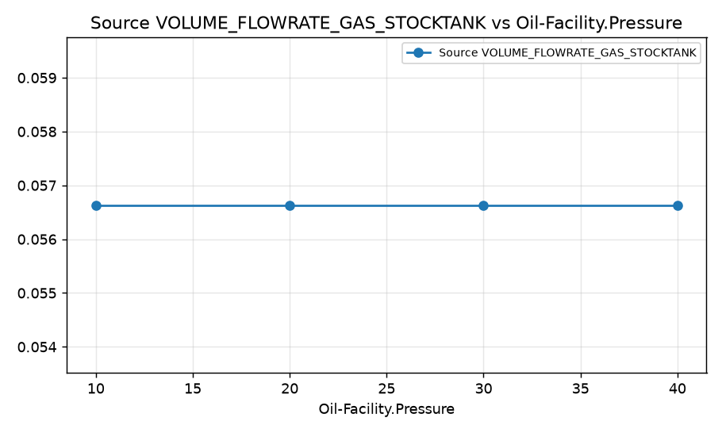

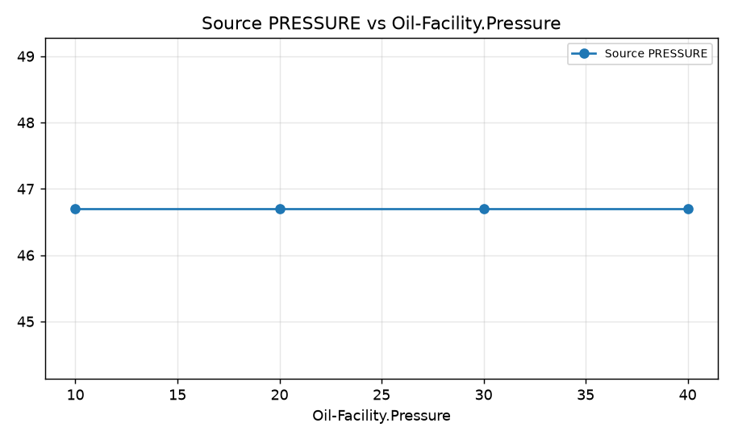

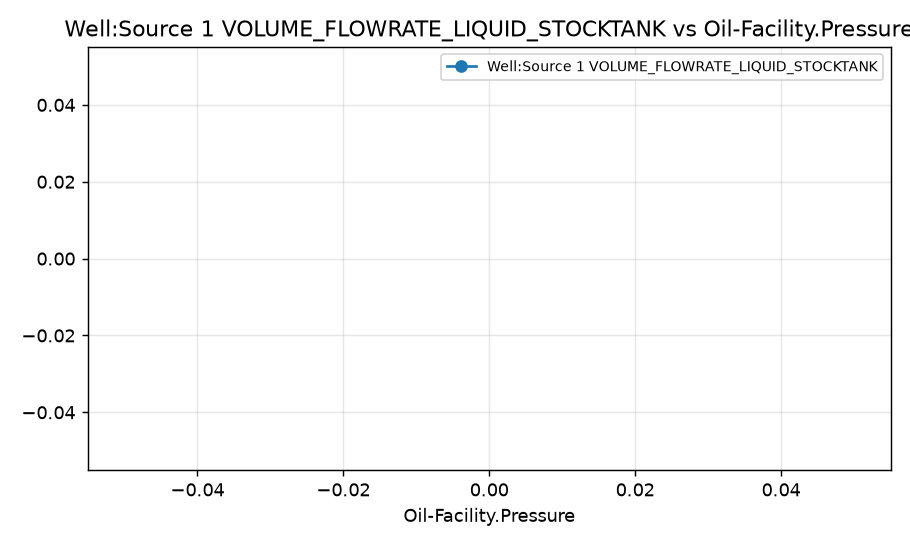

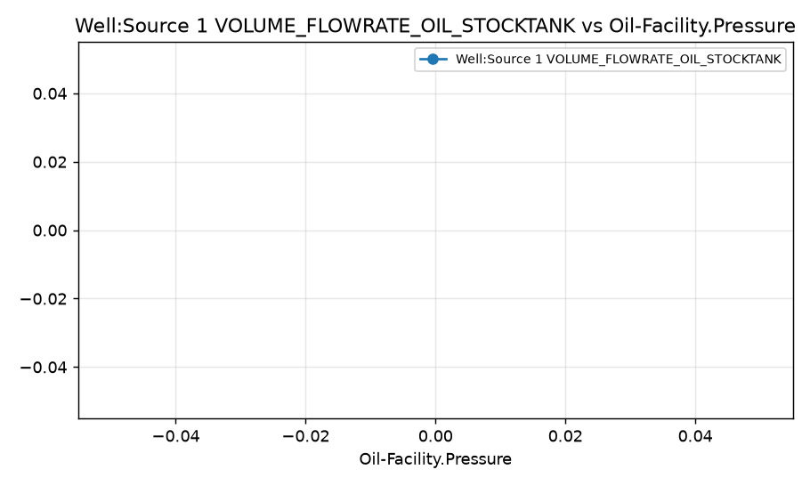

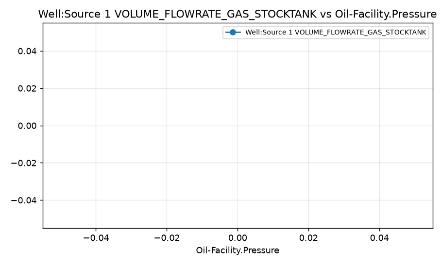

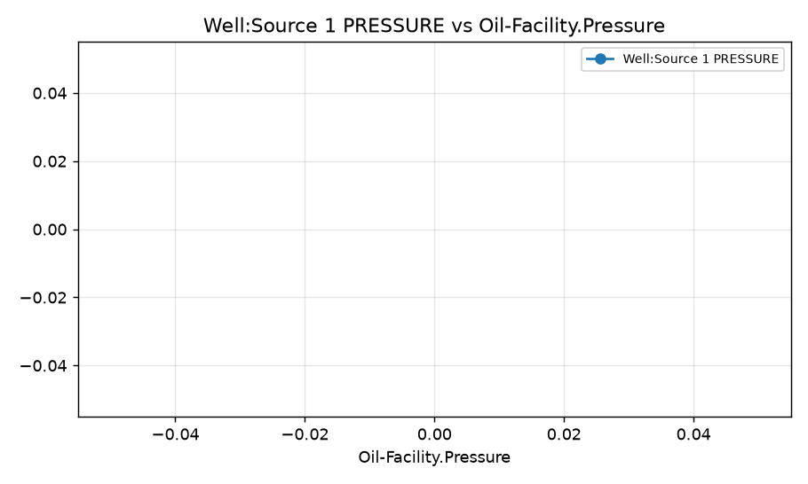

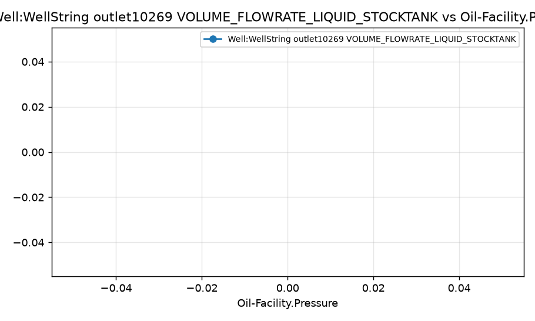

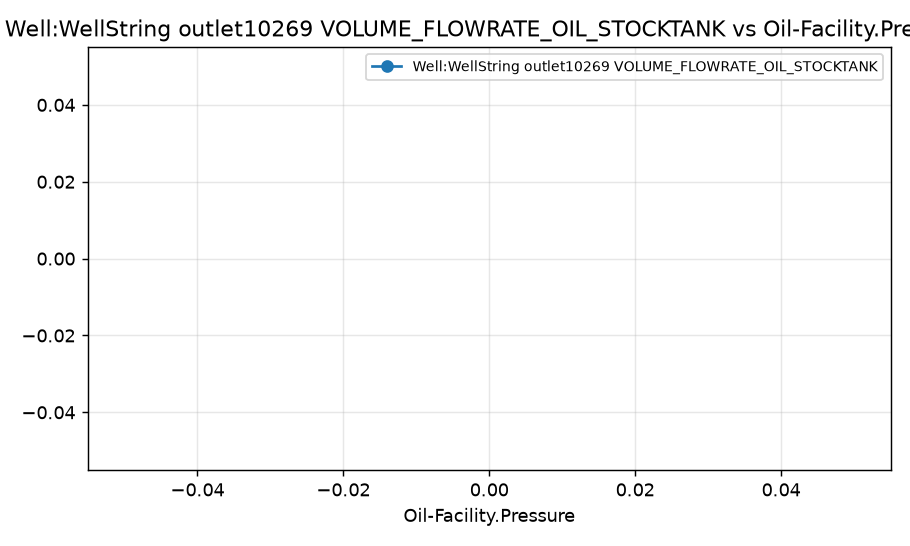

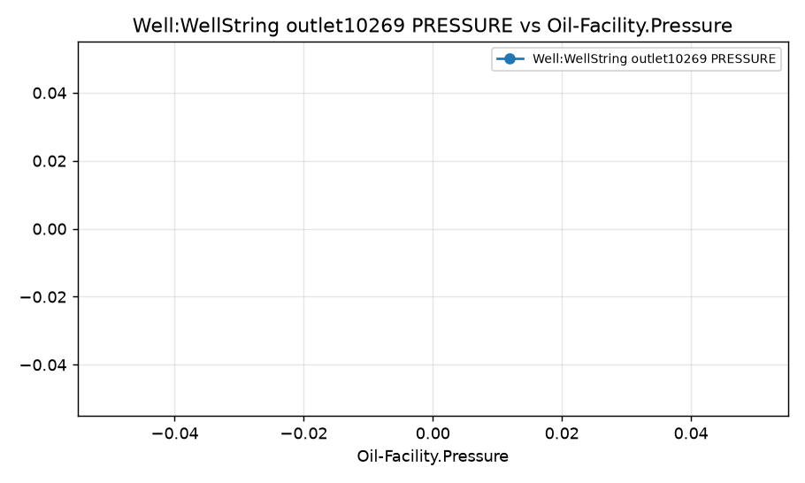

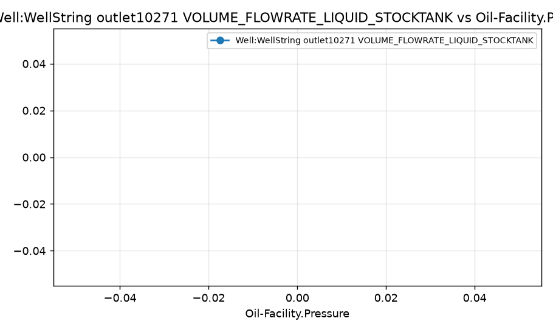

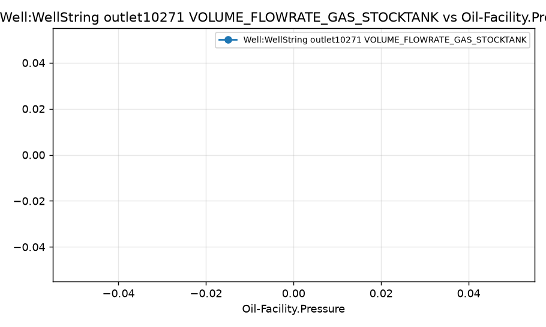

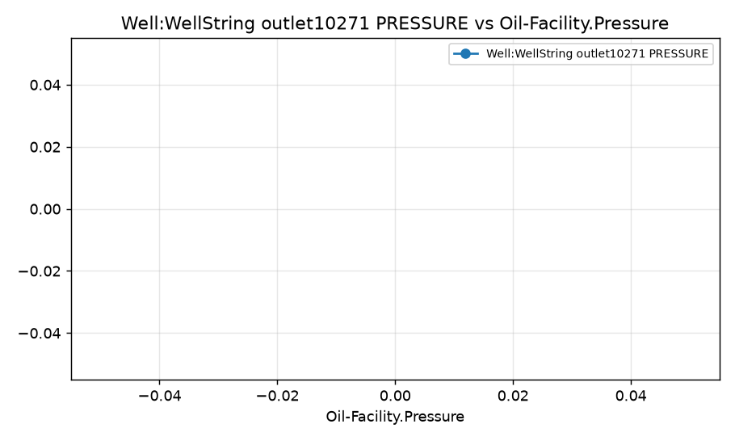
