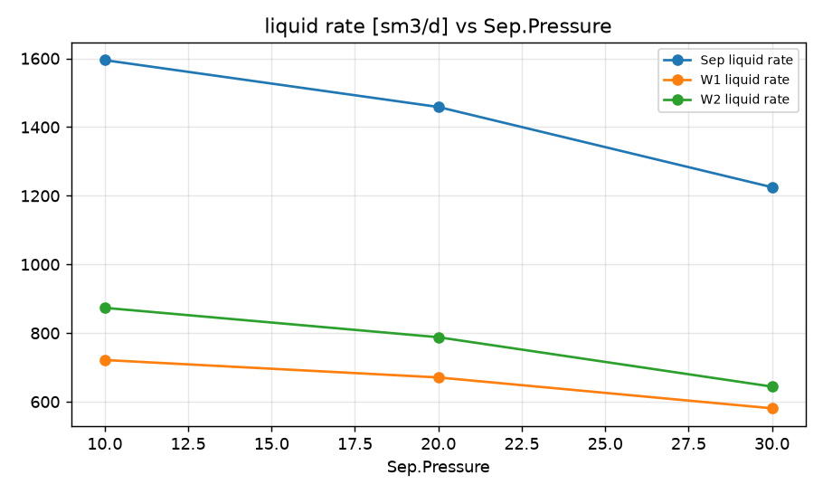
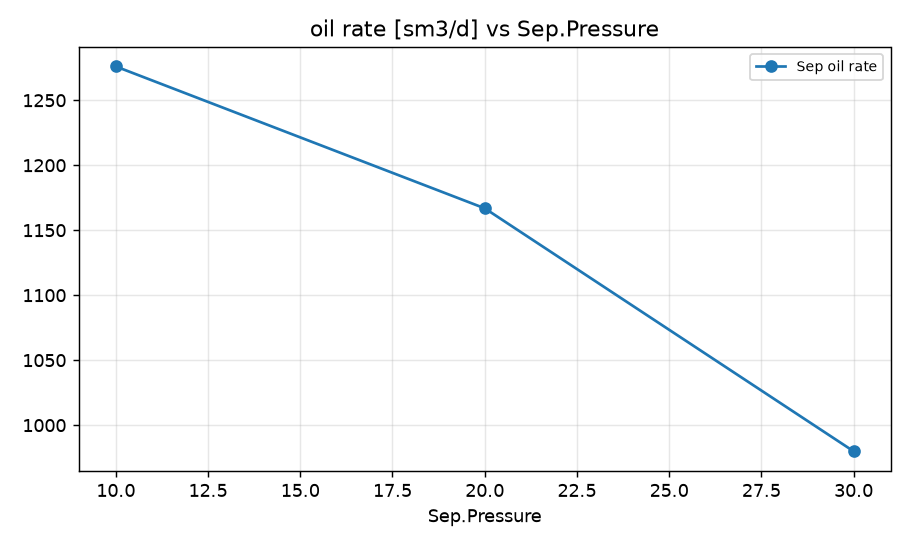
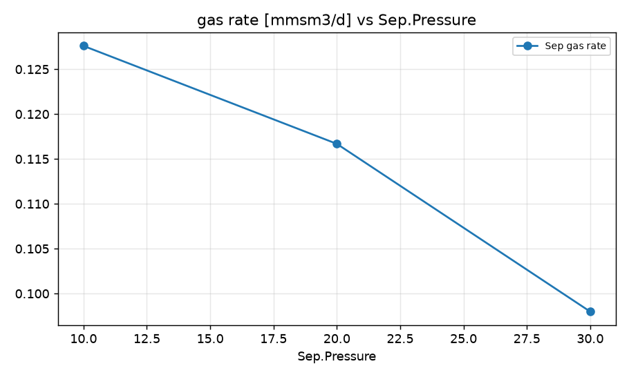
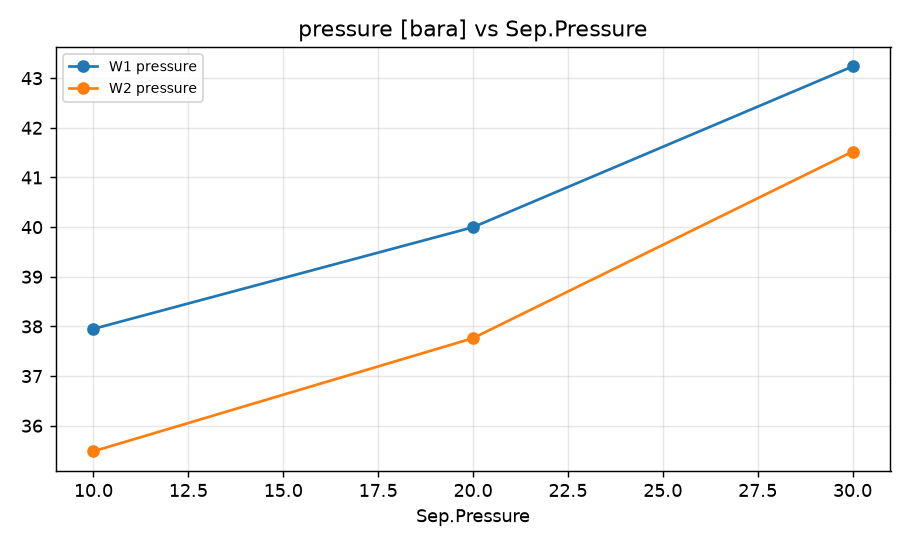

STUDY PLAN: Separator pressure vs field liquid rate
Units: METRIC
1. Build this network as a new PIPESIM model:
   PROJECT: Smoke test field (METRIC)
     fluid     BO: type=black_oil, api=35, gor=100, water_cut=20, gas_sg=0.7
     well      W1: fluid=BO, reservoir_pressure=250, reservoir_temperature=90, ipr={'model': 'pi', 'liquid_pi': 10}, depth=2500, tubing_id=76
     well      W2: fluid=BO, reservoir_pressure=230, reservoir_temperature=90, ipr={'model': 'pi', 'liquid_pi': 15}, depth=2500, tubing_id=76
     sink      Sep: pressure=15
     flowline  FL1: from=CK1, to=J1, length=1500, id=100, elevation_change=0
     flowline  FL2: from=W2, to=J1, length=900, id=100, elevation_change=5
     flowline  FL3: from=J1, to=Sep, length=4000, id=152, elevation_change=10
     choke     CK1: from=W1, bean_size=40
     junction  J1: 
2. Analysis: sweep (vary ONE variable over a range, everything else at base)
     Sink:Sep.Pressure: [10, 20, 30]
3. Results recorded: liquid, oil and gas rate at each sink; liquid rate and pressure at each well and source
4. Total simulation runs: 4. Outputs: CSV, charts, report.md in runs/<timestamp>/

## Results

| case | Sep.Pressure | Sep liquid rate [sm3/d] | Sep oil rate [sm3/d] | Sep gas rate [mmsm3/d] | W1 liquid rate [sm3/d] | W1 pressure [bara] | W2 liquid rate [sm3/d] | W2 pressure [bara] | _status |
|---|---|---|---|---|---|---|---|---|---|
| base | 15 | 1537 | 1230 | 0.123 | 699.9 | 38.81 | 837.4 | 36.43 | Completed |
| Sep.Pressure=10 | 10 | 1595 | 1276 | 0.1276 | 721.5 | 37.95 | 873.5 | 35.49 | Completed |
| Sep.Pressure=20 | 20 | 1459 | 1167 | 0.1167 | 670.7 | 40 | 787.8 | 37.76 | Completed |
| Sep.Pressure=30 | 30 | 1225 | 979.9 | 0.09799 | 580.8 | 43.24 | 644.1 | 41.52 | Completed |

