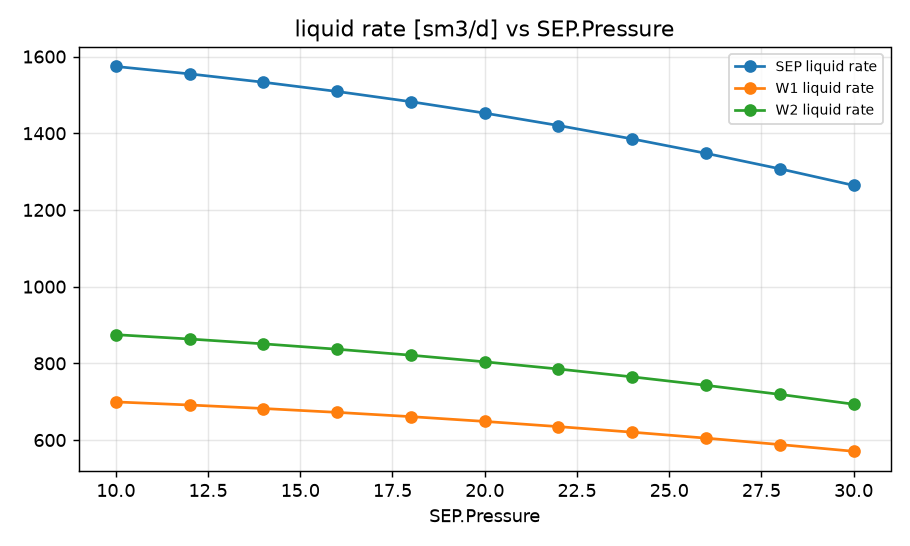
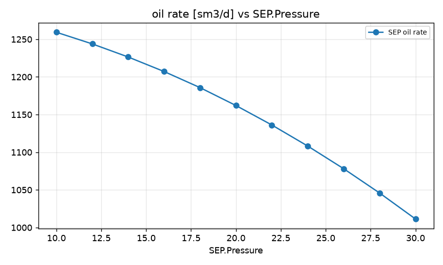
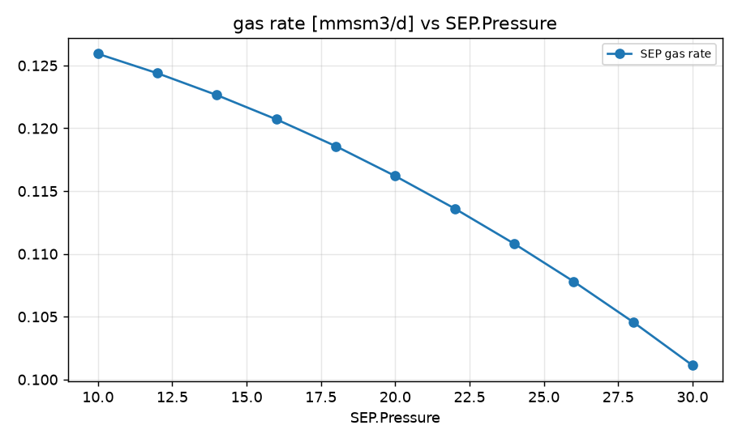
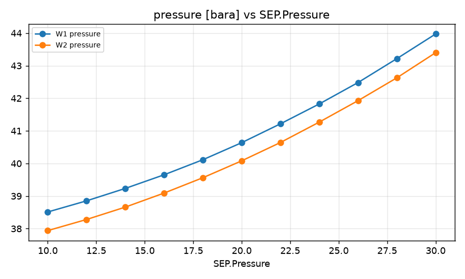

STUDY PLAN: Study how field oil rate changes with separator pressure from 10 to 30 bara
Units: METRIC
1. Build this network as a new PIPESIM model:
   PROJECT: Field A (METRIC)
     fluid     BO: type=black_oil, api=35, gor=100, water_cut=20, gas_sg=0.7
     well      W1: fluid=BO, reservoir_pressure=250, depth=2500, ipr={'model': 'pi', 'liquid_pi': 10}, reservoir_temperature=90.0, tubing_id=76.0
     well      W2: fluid=BO, reservoir_pressure=230, depth=2400, ipr={'model': 'pi', 'liquid_pi': 15}, reservoir_temperature=90.0, tubing_id=76.0
     sink      SEP: pressure=15
     flowline  FL-W1: from=W1, to=J1, length=1500, id=100, elevation_change=0
     flowline  FL-W2: from=W2, to=J1, length=900, id=100, elevation_change=0
     flowline  Trunk: from=J1, to=SEP, length=5000, id=152, elevation_change=10
     junction  J1: 
2. Analysis: sweep (vary ONE variable over a range, everything else at base)
     Sink:SEP.Pressure: [10.0, 12.0, 14.0, 16.0, 18.0, 20.0, 22.0, 24.0, 26.0, 28.0, 30.0]
3. Results recorded: liquid, oil and gas rate at each sink; liquid rate and pressure at each well and source
4. Total simulation runs: 12. Outputs: CSV, charts, report.md in runs/<timestamp>/

## Results

| case | SEP.Pressure | SEP liquid rate [sm3/d] | SEP oil rate [sm3/d] | SEP gas rate [mmsm3/d] | W1 liquid rate [sm3/d] | W1 pressure [bara] | W2 liquid rate [sm3/d] | W2 pressure [bara] | _status |
|---|---|---|---|---|---|---|---|---|---|
| base | 15 | 1521 | 1217 | 0.1217 | 677.3 | 39.44 | 844 | 38.87 | Completed |
| SEP.Pressure=10.0 | 10 | 1574 | 1259 | 0.1259 | 699.4 | 38.51 | 874.7 | 37.94 | Completed |
| SEP.Pressure=12.0 | 12 | 1555 | 1244 | 0.1244 | 691.4 | 38.85 | 863.4 | 38.28 | Completed |
| SEP.Pressure=14.0 | 14 | 1533 | 1226 | 0.1226 | 682.2 | 39.24 | 850.8 | 38.66 | Completed |
| SEP.Pressure=16.0 | 16 | 1509 | 1207 | 0.1207 | 672.1 | 39.65 | 836.8 | 39.09 | Completed |
| SEP.Pressure=18.0 | 18 | 1482 | 1186 | 0.1186 | 661 | 40.12 | 821.2 | 39.56 | Completed |
| SEP.Pressure=20.0 | 20 | 1453 | 1162 | 0.1162 | 648.5 | 40.64 | 804 | 40.08 | Completed |
| SEP.Pressure=22.0 | 22 | 1420 | 1136 | 0.1136 | 635 | 41.22 | 785.2 | 40.64 | Completed |
| SEP.Pressure=24.0 | 24 | 1385 | 1108 | 0.1108 | 620.5 | 41.83 | 764.7 | 41.27 | Completed |
| SEP.Pressure=26.0 | 26 | 1348 | 1078 | 0.1078 | 604.9 | 42.48 | 742.7 | 41.93 | Completed |
| SEP.Pressure=28.0 | 28 | 1307 | 1046 | 0.1046 | 588.2 | 43.22 | 719.1 | 42.63 | Completed |
| SEP.Pressure=30.0 | 30 | 1264 | 1011 | 0.1011 | 570.7 | 43.97 | 693.4 | 43.4 | Completed |

