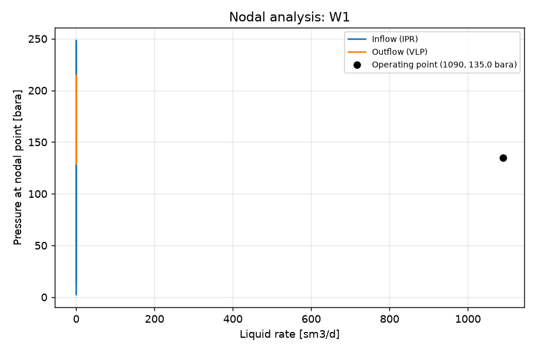

STUDY PLAN: Nodal analysis, natural flow
Units: METRIC
1. Build this network as a new PIPESIM model:
   PROJECT: Nodal test (METRIC)
     fluid     BO: type=black_oil, api=35, gor=100, water_cut=20, gas_sg=0.7
     well      W1: fluid=BO, reservoir_pressure=250, reservoir_temperature=90, ipr={'model': 'pi', 'liquid_pi': 10}, depth=2500, tubing_id=76
     sink      SEP: pressure=15
     flowline  FL: from=W1, to=SEP, length=2000, id=100, elevation_change=0
2. Analysis: nodal (nodal analysis of one well: inflow (IPR) vs outflow (VLP) curves and the operating point)
     well: W1, outlet pressure: 20 bara
3. Results: operating point (liquid, oil, gas rate; flowing bottom-hole pressure), inflow and outflow curves, nodal plot
4. Total simulation runs: 1. Outputs: CSV, charts, report.md in runs/<timestamp>/

## Results

| case | liquid_rate [sm3/d] | oil_rate [sm3/d] | gas_rate [mmsm3/d] | water_rate [sm3/d] | bottomhole_pressure [bara] | outlet_pressure [bara] | _status | curve rate | curve pressure [bara] |
|---|---|---|---|---|---|---|---|---|---|
| operating point | 1090 | 871.9 | 0.08719 | 218 | 135 | 20 | Completed |  |  |
| inflow_0 |  |  |  |  |  |  |  | 0.134 | 2.519 |
| inflow_0 |  |  |  |  |  |  |  | 0.00134 | 248.3 |
| inflow_0 |  |  |  |  |  |  |  | 0.08719 | 135 |
| inflow_0 |  |  |  |  |  |  |  | 0.04427 | 194.7 |
| inflow_0 |  |  |  |  |  |  |  | 0.0228 | 221.5 |
| inflow_0 |  |  |  |  |  |  |  | 0.1106 | 90.16 |
| inflow_0 |  |  |  |  |  |  |  | 0.1223 | 59.01 |
| inflow_0 |  |  |  |  |  |  |  | 0.01207 | 234.9 |
| inflow_0 |  |  |  |  |  |  |  | 0.06573 | 167.1 |
| inflow_0 |  |  |  |  |  |  |  | 0.1282 | 37.72 |
| inflow_0 |  |  |  |  |  |  |  | 0.03353 | 208.1 |
| inflow_0 |  |  |  |  |  |  |  | 0.006706 | 241.6 |
| inflow_0 |  |  |  |  |  |  |  | 0.1311 | 23.56 |
| inflow_0 |  |  |  |  |  |  |  | 0.0989 | 114.4 |
| inflow_0 |  |  |  |  |  |  |  | 0.055 | 181.2 |
| inflow_0 |  |  |  |  |  |  |  | 0.01744 | 228.2 |
| inflow_0 |  |  |  |  |  |  |  | 0.07646 | 151.8 |
| inflow_0 |  |  |  |  |  |  |  | 0.02817 | 214.8 |
| inflow_0 |  |  |  |  |  |  |  | 0.1164 | 75.82 |
| inflow_0 |  |  |  |  |  |  |  | 0.1325 | 14.54 |
| inflow_0 |  |  |  |  |  |  |  | 0.004023 | 245 |
| inflow_0 |  |  |  |  |  |  |  | 0.0389 | 201.4 |
| inflow_0 |  |  |  |  |  |  |  | 0.009389 | 238.3 |
| inflow_0 |  |  |  |  |  |  |  | 0.1047 | 102.9 |
| inflow_0 |  |  |  |  |  |  |  | 0.1252 | 49.15 |
| inflow_0 |  |  |  |  |  |  |  | 0.04963 | 188 |
| inflow_0 |  |  |  |  |  |  |  | 0.09304 | 125.1 |
| inflow_0 |  |  |  |  |  |  |  | 0.06036 | 174.3 |
| inflow_0 |  |  |  |  |  |  |  | 0.01475 | 231.6 |
| inflow_0 |  |  |  |  |  |  |  | 0.0711 | 159.6 |
| outflow_0 |  |  |  |  |  |  |  | nan | nan |
| outflow_0 |  |  |  |  |  |  |  | 0.134 | 143.4 |
| outflow_0 |  |  |  |  |  |  |  | 0.000134 | 214.7 |
| outflow_0 |  |  |  |  |  |  |  | 0.08719 | 135 |
| outflow_0 |  |  |  |  |  |  |  | 0.03496 | 129 |
| outflow_0 |  |  |  |  |  |  |  | 0.01406 | 145.3 |
| outflow_0 |  |  |  |  |  |  |  | 0.005706 | 192.7 |
| outflow_0 |  |  |  |  |  |  |  | 0.05585 | 130.6 |
| outflow_0 |  |  |  |  |  |  |  | 0.1059 | 138.2 |
| outflow_0 |  |  |  |  |  |  |  | 0.009049 | 167.1 |
| outflow_0 |  |  |  |  |  |  |  | 0.06839 | 132.2 |
| outflow_0 |  |  |  |  |  |  |  | 0.02242 | 131 |
| outflow_0 |  |  |  |  |  |  |  | 0.1172 | 140.2 |
| outflow_0 |  |  |  |  |  |  |  | 0.04332 | 129.3 |
| outflow_0 |  |  |  |  |  |  |  | 0.002363 | 207.7 |
| outflow_0 |  |  |  |  |  |  |  | 0.007043 | 183 |
| outflow_0 |  |  |  |  |  |  |  | 0.07591 | 133.3 |
| outflow_0 |  |  |  |  |  |  |  | 0.09468 | 136.3 |
| outflow_0 |  |  |  |  |  |  |  | 0.01105 | 156.1 |
| outflow_0 |  |  |  |  |  |  |  | 0.02744 | 128.9 |
| outflow_0 |  |  |  |  |  |  |  | 0.1239 | 141.4 |
| outflow_0 |  |  |  |  |  |  |  | 0.0037 | 202.5 |
| outflow_0 |  |  |  |  |  |  |  | 0.01741 | 137.5 |
| outflow_0 |  |  |  |  |  |  |  | 0.04833 | 129.7 |
| outflow_0 |  |  |  |  |  |  |  | 0.06087 | 131.1 |
| outflow_0 |  |  |  |  |  |  |  | 0.007845 | 176.2 |
| outflow_0 |  |  |  |  |  |  |  | 0.08042 | 134 |
| outflow_0 |  |  |  |  |  |  |  | 0.09918 | 137 |
| outflow_0 |  |  |  |  |  |  |  | 0.1104 | 139 |

