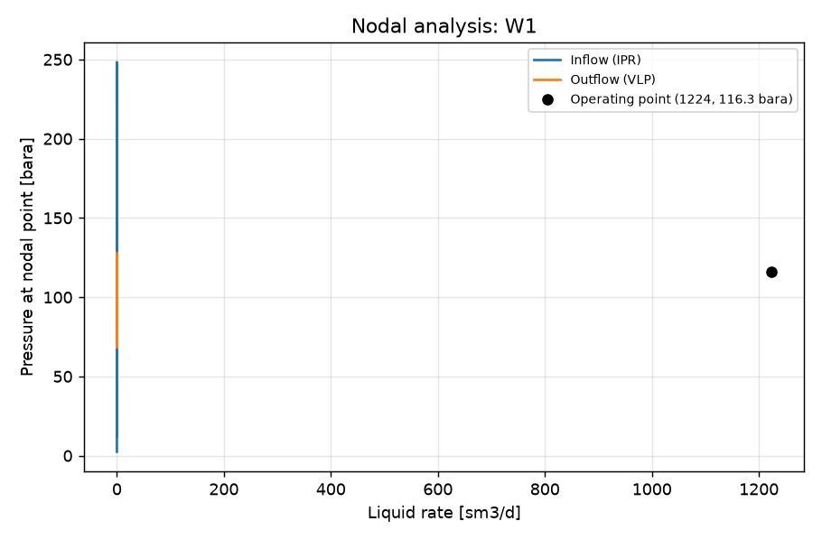

STUDY PLAN: Nodal analysis, gas lift 0.05 mmsm3/d
Units: METRIC
1. Build this network as a new PIPESIM model:
   PROJECT: Nodal test (METRIC)
     fluid     BO: type=black_oil, api=35, gor=100, water_cut=20, gas_sg=0.7
     well      W1: fluid=BO, reservoir_pressure=250, reservoir_temperature=90, ipr={'model': 'pi', 'liquid_pi': 10}, depth=2500, tubing_id=76, gas_lift={'depth': 2000, 'rate': 0.05}
     sink      SEP: pressure=15
     flowline  FL: from=W1, to=SEP, length=2000, id=100, elevation_change=0
2. Analysis: nodal (nodal analysis of one well: inflow (IPR) vs outflow (VLP) curves and the operating point)
     well: W1, outlet pressure: 20 bara
3. Results: operating point (liquid, oil, gas rate; flowing bottom-hole pressure), inflow and outflow curves, nodal plot
4. Total simulation runs: 1. Outputs: CSV, charts, report.md in runs/<timestamp>/

## Results

| case | liquid_rate [sm3/d] | oil_rate [sm3/d] | gas_rate [mmsm3/d] | water_rate [sm3/d] | bottomhole_pressure [bara] | outlet_pressure [bara] | _status | curve rate | curve pressure [bara] |
|---|---|---|---|---|---|---|---|---|---|
| operating point | 1224 | 979.1 | 0.09791 | 244.8 | 116.3 | 20 | Completed |  |  |
| inflow_0 |  |  |  |  |  |  |  | 0.134 | 2.417 |
| inflow_0 |  |  |  |  |  |  |  | 0.00134 | 248.3 |
| inflow_0 |  |  |  |  |  |  |  | 0.09791 | 116.3 |
| inflow_0 |  |  |  |  |  |  |  | 0.04962 | 188 |
| inflow_0 |  |  |  |  |  |  |  | 0.02548 | 218.1 |
| inflow_0 |  |  |  |  |  |  |  | 0.116 | 77.09 |
| inflow_0 |  |  |  |  |  |  |  | 0.01341 | 233.2 |
| inflow_0 |  |  |  |  |  |  |  | 0.07376 | 155.7 |
| inflow_0 |  |  |  |  |  |  |  | 0.125 | 50.01 |
| inflow_0 |  |  |  |  |  |  |  | 0.03755 | 203.1 |
| inflow_0 |  |  |  |  |  |  |  | 0.1295 | 31.65 |
| inflow_0 |  |  |  |  |  |  |  | 0.007376 | 240.8 |
| inflow_0 |  |  |  |  |  |  |  | 0.06169 | 172.5 |
| inflow_0 |  |  |  |  |  |  |  | 0.08584 | 137.2 |
| inflow_0 |  |  |  |  |  |  |  | 0.01945 | 225.7 |
| inflow_0 |  |  |  |  |  |  |  | 0.1318 | 19.61 |
| inflow_0 |  |  |  |  |  |  |  | 0.1069 | 98.28 |
| inflow_0 |  |  |  |  |  |  |  | 0.03152 | 210.6 |
| inflow_0 |  |  |  |  |  |  |  | 0.004358 | 244.5 |
| inflow_0 |  |  |  |  |  |  |  | 0.04359 | 195.5 |
| inflow_0 |  |  |  |  |  |  |  | 0.1205 | 64.6 |
| inflow_0 |  |  |  |  |  |  |  | 0.01039 | 237 |
| inflow_0 |  |  |  |  |  |  |  | 0.1329 | 12.08 |
| inflow_0 |  |  |  |  |  |  |  | 0.05566 | 180.4 |
| inflow_0 |  |  |  |  |  |  |  | 0.06773 | 164.3 |
| inflow_0 |  |  |  |  |  |  |  | 0.01643 | 229.5 |
| inflow_0 |  |  |  |  |  |  |  | 0.09187 | 127.1 |
| inflow_0 |  |  |  |  |  |  |  | 0.0798 | 146.7 |
| inflow_0 |  |  |  |  |  |  |  | 0.1272 | 41.48 |
| inflow_0 |  |  |  |  |  |  |  | 0.1114 | 88.19 |
| outflow_0 |  |  |  |  |  |  |  | nan | nan |
| outflow_0 |  |  |  |  |  |  |  | 0.134 | 127.8 |
| outflow_0 |  |  |  |  |  |  |  | 0.000134 | 68.19 |
| outflow_0 |  |  |  |  |  |  |  | 0.09791 | 116.3 |
| outflow_0 |  |  |  |  |  |  |  | 0.03924 | 91.96 |
| outflow_0 |  |  |  |  |  |  |  | 0.06271 | 102.7 |
| outflow_0 |  |  |  |  |  |  |  | 0.01578 | 79.27 |
| outflow_0 |  |  |  |  |  |  |  | 0.07679 | 108.5 |
| outflow_0 |  |  |  |  |  |  |  | 0.1123 | 121 |
| outflow_0 |  |  |  |  |  |  |  | 0.02516 | 84.67 |
| outflow_0 |  |  |  |  |  |  |  | 0.04863 | 96.35 |
| outflow_0 |  |  |  |  |  |  |  | 0.006391 | 83.37 |
| outflow_0 |  |  |  |  |  |  |  | 0.08524 | 111.7 |
| outflow_0 |  |  |  |  |  |  |  | 0.121 | 123.8 |
| outflow_0 |  |  |  |  |  |  |  | 0.002637 | 73.12 |
| outflow_0 |  |  |  |  |  |  |  | 0.0308 | 87.73 |
| outflow_0 |  |  |  |  |  |  |  | 0.05426 | 98.95 |
| outflow_0 |  |  |  |  |  |  |  | 0.06834 | 105.1 |
| outflow_0 |  |  |  |  |  |  |  | 0.01015 | 83.59 |
| outflow_0 |  |  |  |  |  |  |  | 0.1037 | 118.2 |
| outflow_0 |  |  |  |  |  |  |  | 0.01953 | 81.11 |
| outflow_0 |  |  |  |  |  |  |  | 0.0903 | 113.6 |
| outflow_0 |  |  |  |  |  |  |  | 0.1262 | 125.4 |
| outflow_0 |  |  |  |  |  |  |  | 0.004139 | 78.5 |
| outflow_0 |  |  |  |  |  |  |  | 0.043 | 93.72 |
| outflow_0 |  |  |  |  |  |  |  | 0.03417 | 89.46 |
| outflow_0 |  |  |  |  |  |  |  | 0.05764 | 100.5 |
| outflow_0 |  |  |  |  |  |  |  | 0.0124 | 81.64 |
| outflow_0 |  |  |  |  |  |  |  | 0.07172 | 106.5 |

