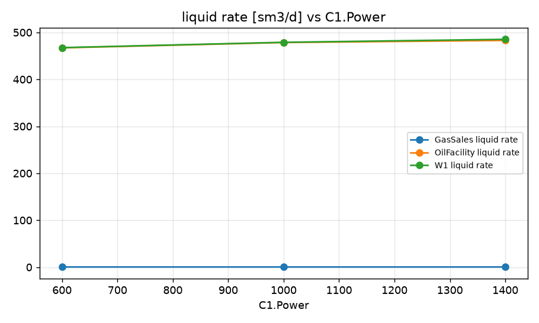
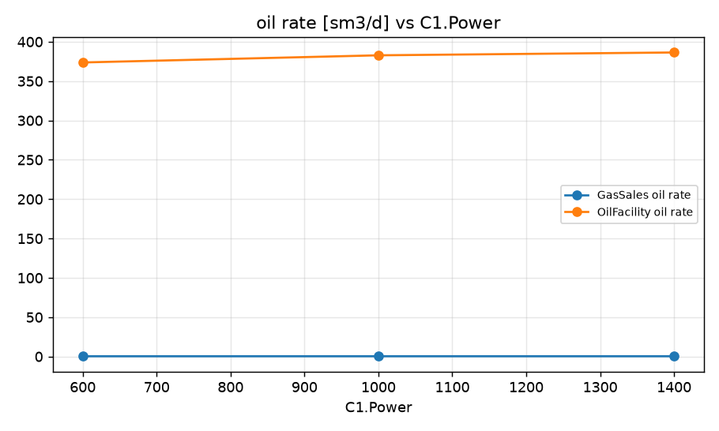
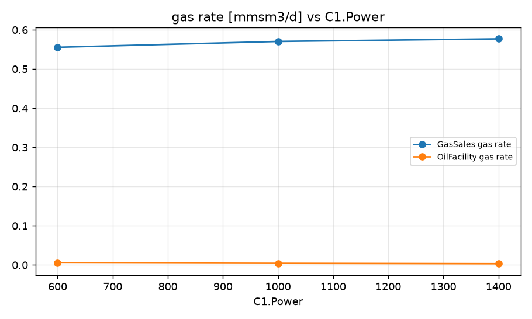
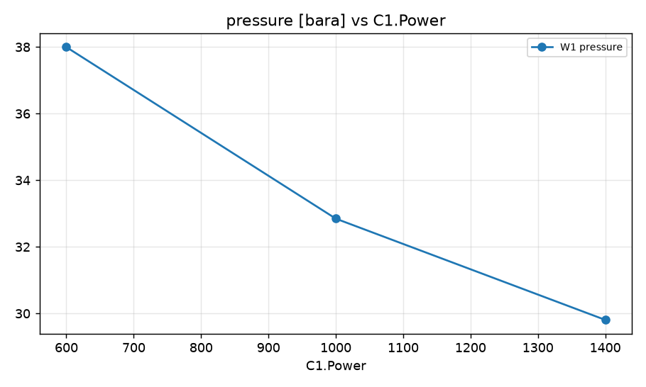

STUDY PLAN: Compressor power vs production
Units: METRIC
1. Build this network as a new PIPESIM model:
   PROJECT: Facility test (METRIC)
     fluid     BF: type=black_oil, api=32, gor=1500, water_cut=20, gas_sg=0.65
     well      W1: fluid=BF, reservoir_pressure=200, reservoir_temperature=55, ipr={'model': 'pi', 'liquid_pi': 5}, depth=1500, tubing_id=100
     sink      GasSales: pressure=41.4
     sink      OilFacility: pressure=20.7
     flowline  FL-1: from=W1, to=CK, length=61, id=154, elevation_change=3
     flowline  FL-2: from=CK, to=MAN, length=61, id=154, elevation_change=3
     flowline  FL-4: from=MAN, to=SEP1, length=30, id=154, elevation_change=0
     flowline  GL-1: from=SEP1, port=gas, to=C1, length=7, id=154, elevation_change=3
     flowline  GL-2: from=C1, to=GasSales, length=6096, id=154, elevation_change=0
     flowline  LL-1: from=SEP1, port=liquid, to=P1, length=61, id=154, elevation_change=3
     flowline  LL-2: from=P1, to=OilFacility, length=3109, id=154, elevation_change=0
     choke     CK: bean_size=50.8
     junction  MAN: 
     separator SEP1: efficiency=99.9
     pump      P1: efficiency=70, power=350
     compressor C1: efficiency=70, power=1000
2. Analysis: sweep (vary ONE variable over a range, everything else at base)
     Compressor:C1.Power: [600, 1000, 1400]
3. Results recorded: liquid, oil and gas rate at each sink; liquid rate and pressure at each well and source
4. Total simulation runs: 4. Outputs: CSV, charts, report.md in runs/<timestamp>/

## Results

| case | C1.Power | GasSales liquid rate [sm3/d] | GasSales oil rate [sm3/d] | GasSales gas rate [mmsm3/d] | OilFacility liquid rate [sm3/d] | OilFacility oil rate [sm3/d] | OilFacility gas rate [mmsm3/d] | W1 liquid rate [sm3/d] | W1 pressure [bara] | _status | GasSales oil rate change vs base [%] |
|---|---|---|---|---|---|---|---|---|---|---|---|
| base | 1000 | 0.4789 | 0.3831 | 0.5704 | 478.4 | 382.8 | 0.004248 | 478.9 | 32.85 | Completed | 0 |
| C1.Power=600 | 600 | 0.4676 | 0.374 | 0.5555 | 467.1 | 373.7 | 0.00555 | 467.6 | 38 | Completed | -2.37 |
| C1.Power=1000 | 1000 | 0.4789 | 0.3831 | 0.5704 | 478.4 | 382.8 | 0.004248 | 478.9 | 32.85 | Completed | 0 |
| C1.Power=1400 | 1400 | 0.4836 | 0.3869 | 0.5771 | 483 | 386.4 | 0.003256 | 485.3 | 29.81 | Completed | 0.99 |

