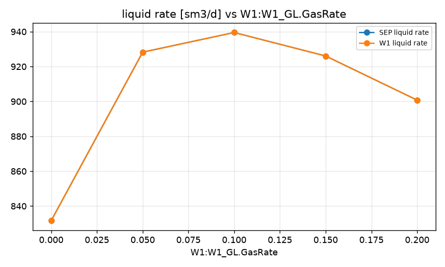
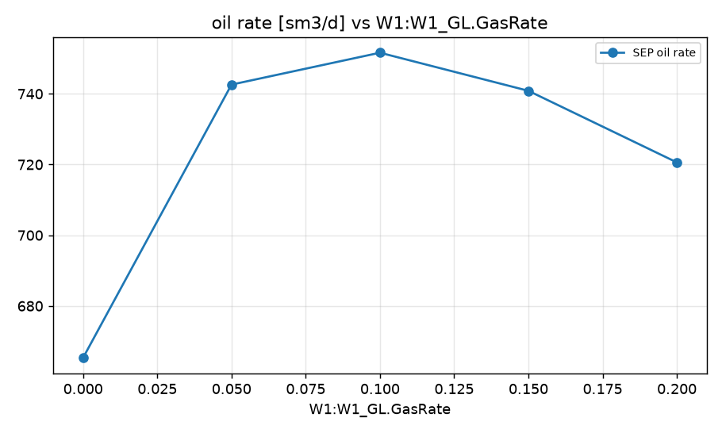
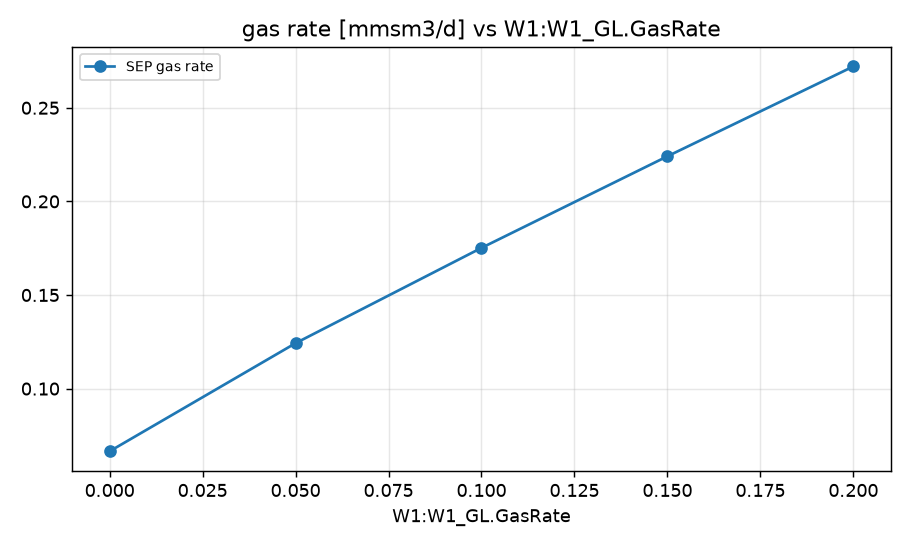
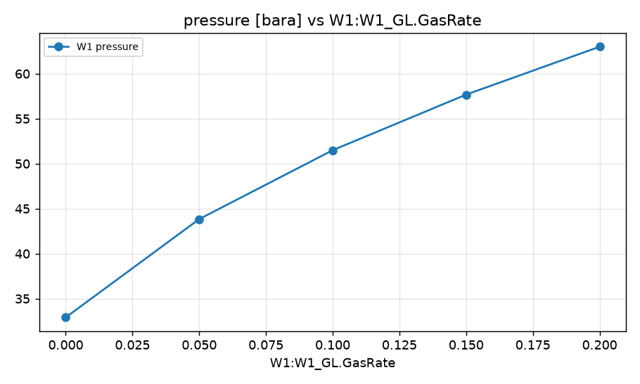

STUDY PLAN: Analyze well performance at 20 bara wellhead pressure
Units: METRIC
1. Build this network as a new PIPESIM model:
   PROJECT: Field W1 (METRIC)
     fluid     BO: type=black_oil, api=35, gor=100, water_cut=20, gas_sg=0.7
     well      W1: fluid=BO, reservoir_pressure=250, reservoir_temperature=90, depth=2500, tubing_id=76, ipr={'model': 'pi', 'liquid_pi': 10}, gas_lift={'depth': 2000, 'rate': 0.05}
     sink      SEP: pressure=15
     flowline  FL-W1: from=W1, to=J1, length=2000, id=100, elevation_change=0
     flowline  FL-J1-SEP: from=J1, to=SEP, length=0, id=100, elevation_change=0
     junction  J1: 
2. Analysis: sweep (vary ONE variable over a range, everything else at base)
     GasLiftInjection:W1:W1_GL.GasRate: [0.0, 0.05, 0.1, 0.15, 0.2]
3. Results recorded: liquid, oil and gas rate at each sink; liquid rate and pressure at each well and source
4. Total simulation runs: 6. Outputs: CSV, charts, report.md in runs/<timestamp>/

## Results

| case | W1:W1_GL.GasRate | SEP liquid rate [sm3/d] | SEP oil rate [sm3/d] | SEP gas rate [mmsm3/d] | W1 liquid rate [sm3/d] | W1 pressure [bara] | _status | SEP oil rate change vs base [%] |
|---|---|---|---|---|---|---|---|---|
| base | 0.05 | 928.3 | 742.6 | 0.1243 | 928.3 | 43.84 | Completed | 0 |
| W1:W1_GL.GasRate=0.0 | 0 | 831.6 | 665.3 | 0.06653 | 831.6 | 32.92 | Completed | -10.41 |
| W1:W1_GL.GasRate=0.05 | 0.05 | 928.3 | 742.6 | 0.1243 | 928.3 | 43.84 | Completed | 0 |
| W1:W1_GL.GasRate=0.1 | 0.1 | 939.5 | 751.6 | 0.1752 | 939.5 | 51.5 | Completed | 1.21 |
| W1:W1_GL.GasRate=0.15 | 0.15 | 926.1 | 740.9 | 0.2241 | 926.1 | 57.68 | Completed | -0.24 |
| W1:W1_GL.GasRate=0.2 | 0.2 | 900.8 | 720.6 | 0.2721 | 900.8 | 63 | Completed | -2.96 |

