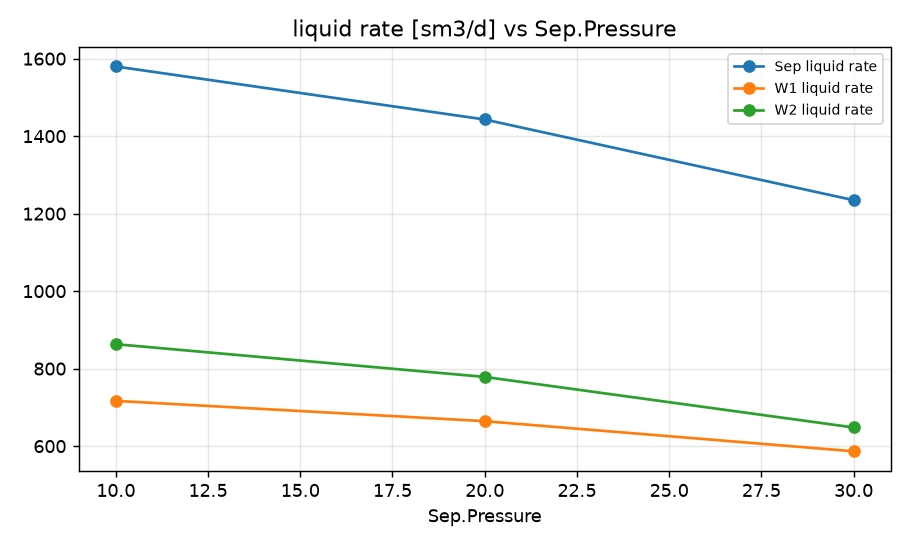
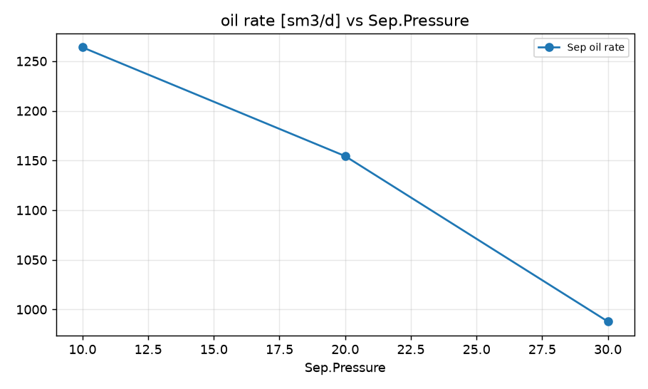
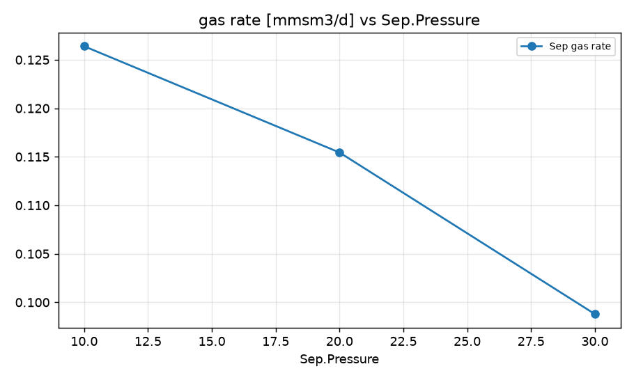
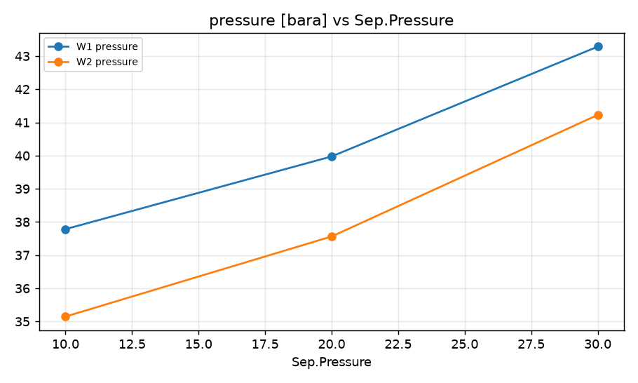

STUDY PLAN: Separator pressure vs field liquid rate
Units: METRIC
1. Build this network as a new PIPESIM model:
   PROJECT: Smoke test field (METRIC)
     fluid     BO: type=black_oil, api=35, gor=100, water_cut=20, gas_sg=0.7
     well      W1: fluid=BO, reservoir_pressure=250, reservoir_temperature=90, ipr={'model': 'pi', 'liquid_pi': 10}, depth=2500, tubing_id=76
     well      W2: fluid=BO, reservoir_pressure=230, reservoir_temperature=90, ipr={'model': 'pi', 'liquid_pi': 15}, depth=2500, tubing_id=76
     sink      Sep: pressure=15
     flowline  FL1: from=CK1, to=J1, length=1500, id=100, elevation_change=0
     flowline  FL2: from=W2, to=J1, length=900, id=100, elevation_change=5
     flowline  FL3: from=J1, to=Sep, length=4000, id=152, elevation_change=10
     choke     CK1: from=W1, bean_size=40
     junction  J1: 
2. Analysis: sweep (vary ONE variable over a range, everything else at base)
     Sink:Sep.Pressure: [10, 20, 30]
3. Results recorded: liquid, oil and gas rate at each sink; liquid rate and pressure at each well and source
4. Total simulation runs: 4. Outputs: CSV, charts, report.md in runs/<timestamp>/

## Results

| case | Sep.Pressure | Sep liquid rate [sm3/d] | Sep oil rate [sm3/d] | Sep gas rate [mmsm3/d] | W1 liquid rate [sm3/d] | W1 pressure [bara] | W2 liquid rate [sm3/d] | W2 pressure [bara] | _status | Sep oil rate change vs base [%] |
|---|---|---|---|---|---|---|---|---|---|---|
| base | 15 | 1517 | 1213 | 0.1213 | 691.8 | 38.83 | 825 | 36.25 | Completed | 0 |
| Sep.Pressure=10 | 10 | 1580 | 1264 | 0.1264 | 716.8 | 37.78 | 863.1 | 35.15 | Completed | 4.16 |
| Sep.Pressure=20 | 20 | 1443 | 1154 | 0.1154 | 664.4 | 39.97 | 778.6 | 37.56 | Completed | -4.86 |
| Sep.Pressure=30 | 30 | 1235 | 987.9 | 0.09879 | 586.7 | 43.28 | 648.2 | 41.23 | Completed | -18.59 |

