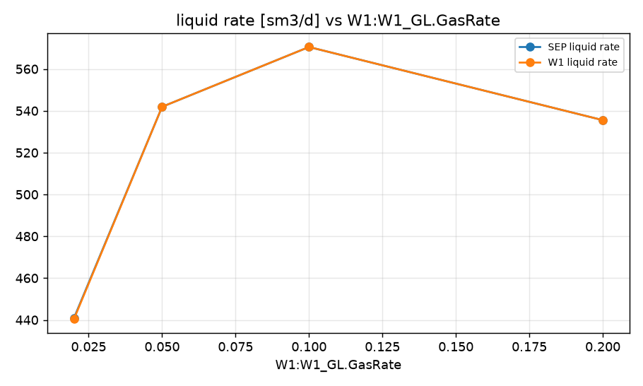
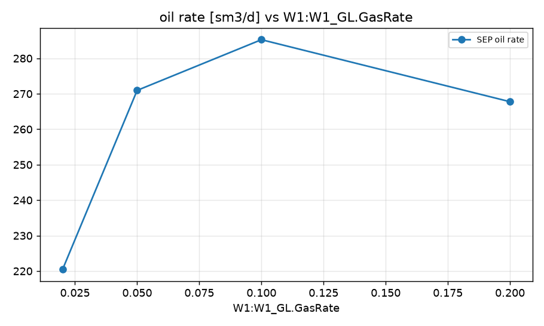
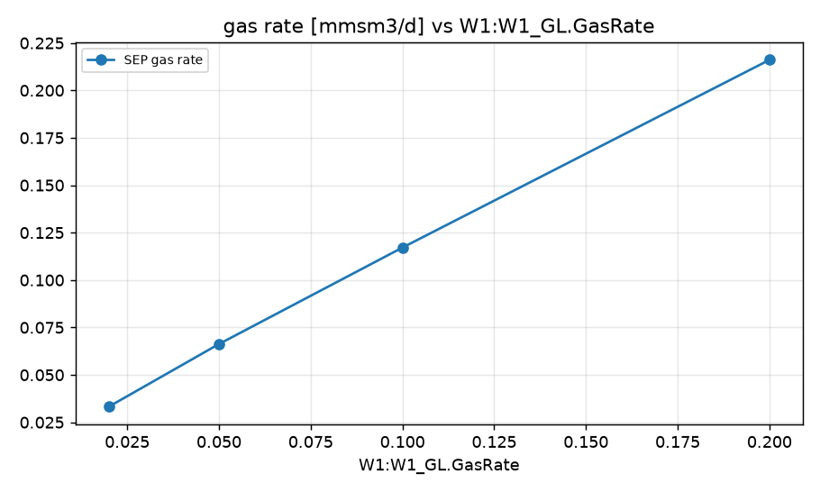
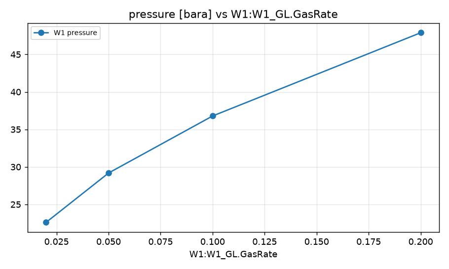

STUDY PLAN: Gas lift performance curve
Units: METRIC
1. Build this network as a new PIPESIM model:
   PROJECT: Gas lift test (METRIC)
     fluid     BO: type=black_oil, api=30, gor=60, water_cut=50, gas_sg=0.7
     well      W1: fluid=BO, reservoir_pressure=200, reservoir_temperature=90, ipr={'model': 'pi', 'liquid_pi': 8}, depth=2500, tubing_id=76, gas_lift={'depth': 2200, 'rate': 0.05}
     sink      SEP: pressure=15
     flowline  FL: from=W1, to=SEP, length=2000, id=100, elevation_change=0
2. Analysis: sweep (vary ONE variable over a range, everything else at base)
     GasLiftInjection:W1:W1_GL.GasRate: [0.0, 0.02, 0.05, 0.1, 0.2]
3. Results recorded: liquid, oil and gas rate at each sink; liquid rate and pressure at each well and source
4. Total simulation runs: 6. Outputs: CSV, charts, report.md in runs/<timestamp>/

## Results

| case | W1:W1_GL.GasRate | SEP liquid rate [sm3/d] | SEP oil rate [sm3/d] | SEP gas rate [mmsm3/d] | W1 liquid rate [sm3/d] | W1 pressure [bara] | _status | SEP oil rate change vs base [%] |
|---|---|---|---|---|---|---|---|---|
| base | 0.05 | 541.9 | 271 | 0.06626 | 541.9 | 29.18 | Completed | 0 |
| W1:W1_GL.GasRate=0.0 | 0 |  |  |  |  |  | Completed: no results - the system may not flow at these conditions |  |
| W1:W1_GL.GasRate=0.02 | 0.02 | 440.9 | 220.5 | 0.03325 | 440.4 | 22.6 | Completed | -18.64 |
| W1:W1_GL.GasRate=0.05 | 0.05 | 541.9 | 271 | 0.06626 | 541.9 | 29.18 | Completed | 0 |
| W1:W1_GL.GasRate=0.1 | 0.1 | 570.5 | 285.3 | 0.1171 | 570.5 | 36.79 | Completed | 5.28 |
| W1:W1_GL.GasRate=0.2 | 0.2 | 535.5 | 267.8 | 0.2161 | 535.5 | 47.89 | Completed | -1.18 |

