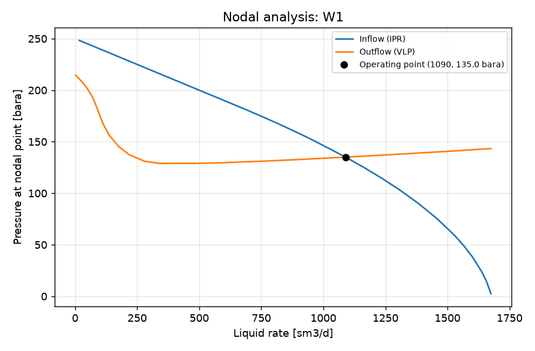

STUDY PLAN: Nodal analysis, natural flow
Units: METRIC
1. Build this network as a new PIPESIM model:
   PROJECT: Nodal test (METRIC)
     fluid     BO: type=black_oil, api=35, gor=100, water_cut=20, gas_sg=0.7
     well      W1: fluid=BO, reservoir_pressure=250, reservoir_temperature=90, ipr={'model': 'pi', 'liquid_pi': 10}, depth=2500, tubing_id=76
     sink      SEP: pressure=15
     flowline  FL: from=W1, to=SEP, length=2000, id=100, elevation_change=0
2. Analysis: nodal (nodal analysis of one well: inflow (IPR) vs outflow (VLP) curves and the operating point)
     well: W1, outlet pressure: 20 bara
3. Results: operating point (liquid, oil, gas rate; flowing bottom-hole pressure), inflow and outflow curves, nodal plot
4. Total simulation runs: 1. Outputs: CSV, charts, report.md in runs/<timestamp>/

## Results

| case | liquid_rate [sm3/d] | oil_rate [sm3/d] | reservoir_gas_rate [mmsm3/d] | water_rate [sm3/d] | bottomhole_pressure [bara] | outlet_pressure [bara] | _status | curve rate | curve pressure [bara] |
|---|---|---|---|---|---|---|---|---|---|
| operating point | 1090 | 871.9 | 0.08719 | 218 | 135 | 20 | Completed |  |  |
| inflow_0 |  |  |  |  |  |  |  | 16.75 | 248.3 |
| inflow_0 |  |  |  |  |  |  |  | 50.29 | 245 |
| inflow_0 |  |  |  |  |  |  |  | 83.82 | 241.6 |
| inflow_0 |  |  |  |  |  |  |  | 117.4 | 238.3 |
| inflow_0 |  |  |  |  |  |  |  | 150.9 | 234.9 |
| inflow_0 |  |  |  |  |  |  |  | 184.4 | 231.6 |
| inflow_0 |  |  |  |  |  |  |  | 218 | 228.2 |
| inflow_0 |  |  |  |  |  |  |  | 285 | 221.5 |
| inflow_0 |  |  |  |  |  |  |  | 352.1 | 214.8 |
| inflow_0 |  |  |  |  |  |  |  | 419.2 | 208.1 |
| inflow_0 |  |  |  |  |  |  |  | 486.3 | 201.4 |
| inflow_0 |  |  |  |  |  |  |  | 553.3 | 194.7 |
| inflow_0 |  |  |  |  |  |  |  | 620.4 | 188 |
| inflow_0 |  |  |  |  |  |  |  | 687.5 | 181.2 |
| inflow_0 |  |  |  |  |  |  |  | 754.5 | 174.3 |
| inflow_0 |  |  |  |  |  |  |  | 821.6 | 167.1 |
| inflow_0 |  |  |  |  |  |  |  | 888.7 | 159.6 |
| inflow_0 |  |  |  |  |  |  |  | 955.8 | 151.8 |
| inflow_0 |  |  |  |  |  |  |  | 1090 | 135 |
| inflow_0 |  |  |  |  |  |  |  | 1163 | 125.1 |
| inflow_0 |  |  |  |  |  |  |  | 1236 | 114.4 |
| inflow_0 |  |  |  |  |  |  |  | 1309 | 102.9 |
| inflow_0 |  |  |  |  |  |  |  | 1382 | 90.16 |
| inflow_0 |  |  |  |  |  |  |  | 1456 | 75.82 |
| inflow_0 |  |  |  |  |  |  |  | 1529 | 59.01 |
| inflow_0 |  |  |  |  |  |  |  | 1565 | 49.15 |
| inflow_0 |  |  |  |  |  |  |  | 1602 | 37.72 |
| inflow_0 |  |  |  |  |  |  |  | 1638 | 23.56 |
| inflow_0 |  |  |  |  |  |  |  | 1657 | 14.54 |
| inflow_0 |  |  |  |  |  |  |  | 1675 | 2.519 |
| outflow_0 |  |  |  |  |  |  |  | 1.675 | 214.7 |
| outflow_0 |  |  |  |  |  |  |  | 29.53 | 207.7 |
| outflow_0 |  |  |  |  |  |  |  | 46.25 | 202.5 |
| outflow_0 |  |  |  |  |  |  |  | 56.28 | 199 |
| outflow_0 |  |  |  |  |  |  |  | 71.32 | 192.7 |
| outflow_0 |  |  |  |  |  |  |  | 88.04 | 183 |
| outflow_0 |  |  |  |  |  |  |  | 98.07 | 176.2 |
| outflow_0 |  |  |  |  |  |  |  | 113.1 | 167.1 |
| outflow_0 |  |  |  |  |  |  |  | 138.2 | 156.1 |
| outflow_0 |  |  |  |  |  |  |  | 175.8 | 145.3 |
| outflow_0 |  |  |  |  |  |  |  | 217.6 | 137.5 |
| outflow_0 |  |  |  |  |  |  |  | 280.3 | 131 |
| outflow_0 |  |  |  |  |  |  |  | 342.9 | 128.9 |
| outflow_0 |  |  |  |  |  |  |  | 437 | 129 |
| outflow_0 |  |  |  |  |  |  |  | 478.8 | 129 |
| outflow_0 |  |  |  |  |  |  |  | 541.4 | 129.3 |
| outflow_0 |  |  |  |  |  |  |  | 604.1 | 129.7 |
| outflow_0 |  |  |  |  |  |  |  | 698.1 | 130.6 |
| outflow_0 |  |  |  |  |  |  |  | 760.8 | 131.1 |
| outflow_0 |  |  |  |  |  |  |  | 854.9 | 132.2 |
| outflow_0 |  |  |  |  |  |  |  | 948.9 | 133.3 |
| outflow_0 |  |  |  |  |  |  |  | 1005 | 134 |
| outflow_0 |  |  |  |  |  |  |  | 1090 | 135 |
| outflow_0 |  |  |  |  |  |  |  | 1184 | 136.3 |
| outflow_0 |  |  |  |  |  |  |  | 1240 | 137 |
| outflow_0 |  |  |  |  |  |  |  | 1324 | 138.2 |
| outflow_0 |  |  |  |  |  |  |  | 1380 | 139 |
| outflow_0 |  |  |  |  |  |  |  | 1464 | 140.2 |
| outflow_0 |  |  |  |  |  |  |  | 1549 | 141.4 |

