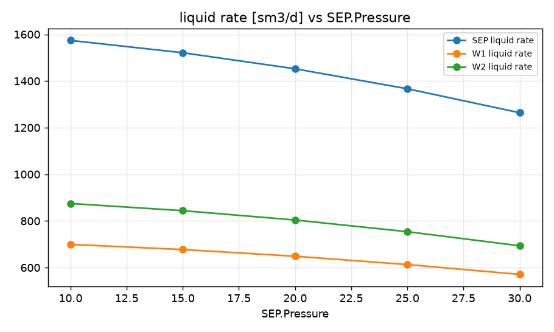
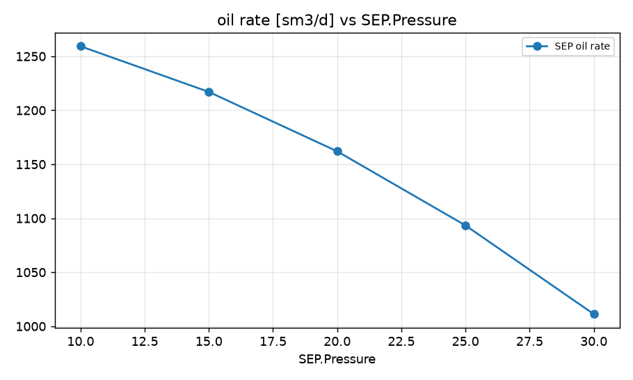
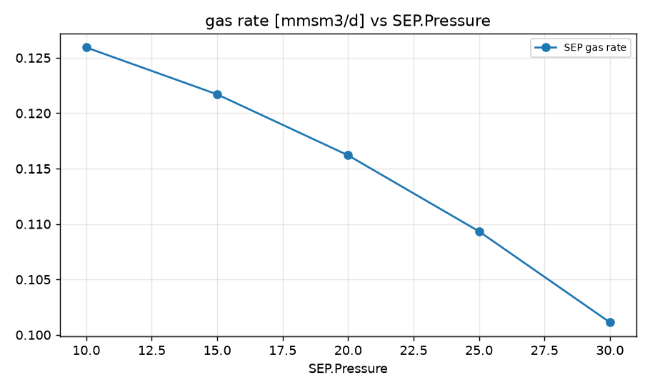
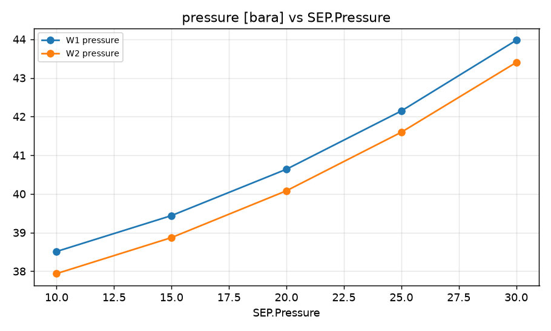

STUDY PLAN: Sweep of SEP.Pressure
Units: METRIC
1. Build this network as a new PIPESIM model:
   PROJECT: Field A (METRIC)
     fluid     BO: type=black_oil, api=35, gor=100, water_cut=20, gas_sg=0.7
     well      W1: fluid=BO, reservoir_pressure=250, depth=2500, ipr={'model': 'pi', 'liquid_pi': 10}, reservoir_temperature=90.0, tubing_id=76.0
     well      W2: fluid=BO, reservoir_pressure=230, depth=2400, ipr={'model': 'pi', 'liquid_pi': 15}, reservoir_temperature=90.0, tubing_id=76.0
     sink      SEP: pressure=15
     flowline  FL-W1: from=W1, to=J1, length=1500, id=100, elevation_change=0
     flowline  FL-W2: from=W2, to=J1, length=900, id=100, elevation_change=0
     flowline  Trunk: from=J1, to=SEP, length=5000, id=152, elevation_change=10
     junction  J1: 
2. Analysis: sweep (vary ONE variable over a range, everything else at base)
     Sink:SEP.Pressure: [10, 15, 20, 25, 30]
3. Results recorded: liquid, oil and gas rate at each sink; liquid rate and pressure at each well and source
4. Total simulation runs: 6. Outputs: CSV, charts, report.md in runs/<timestamp>/

## Results

| case | SEP.Pressure | SEP liquid rate [sm3/d] | SEP oil rate [sm3/d] | SEP gas rate [mmsm3/d] | W1 liquid rate [sm3/d] | W1 pressure [bara] | W2 liquid rate [sm3/d] | W2 pressure [bara] | _status | SEP oil rate change vs base [%] |
|---|---|---|---|---|---|---|---|---|---|---|
| base | 15 | 1521 | 1217 | 0.1217 | 677.3 | 39.44 | 844 | 38.87 | Completed | 0 |
| SEP.Pressure=10 | 10 | 1574 | 1259 | 0.1259 | 699.4 | 38.51 | 874.7 | 37.94 | Completed | 3.47 |
| SEP.Pressure=15 | 15 | 1521 | 1217 | 0.1217 | 677.3 | 39.44 | 844 | 38.87 | Completed | 0 |
| SEP.Pressure=20 | 20 | 1453 | 1162 | 0.1162 | 648.5 | 40.64 | 804 | 40.08 | Completed | -4.52 |
| SEP.Pressure=25 | 25 | 1367 | 1093 | 0.1093 | 612.9 | 42.15 | 753.8 | 41.6 | Completed | -10.16 |
| SEP.Pressure=30 | 30 | 1264 | 1011 | 0.1011 | 570.7 | 43.97 | 693.4 | 43.4 | Completed | -16.9 |

