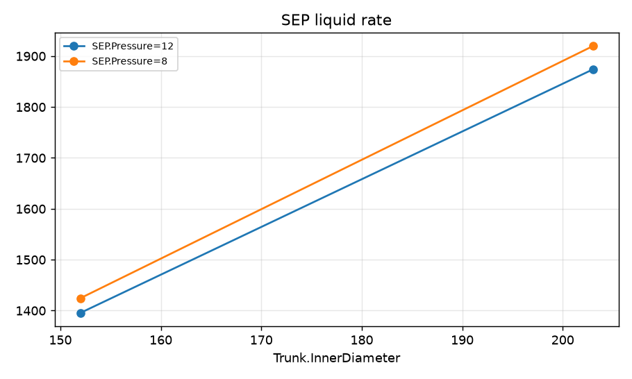
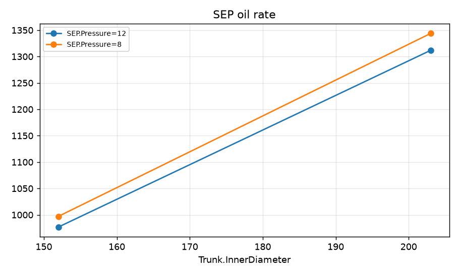
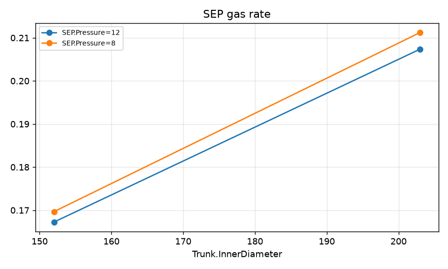
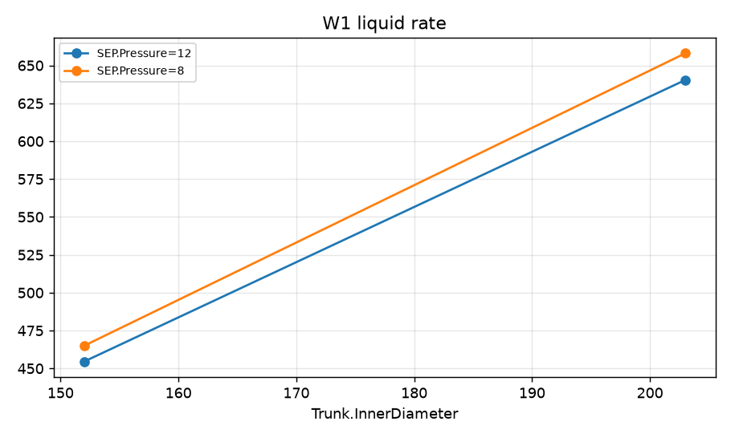
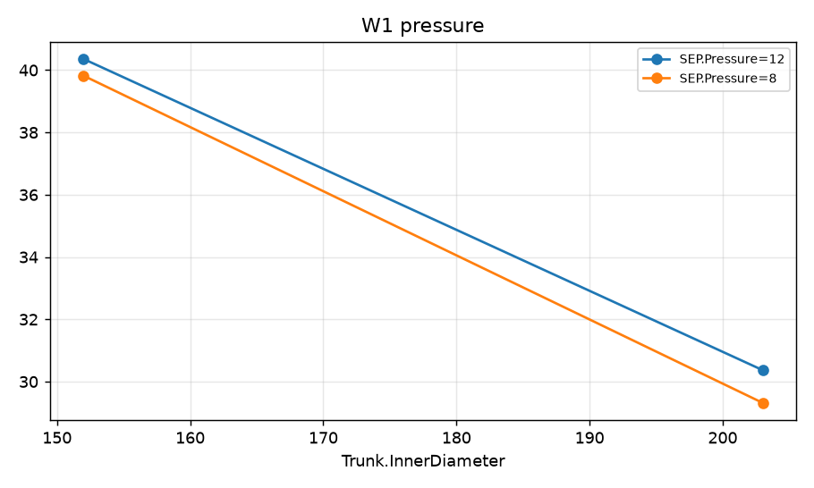
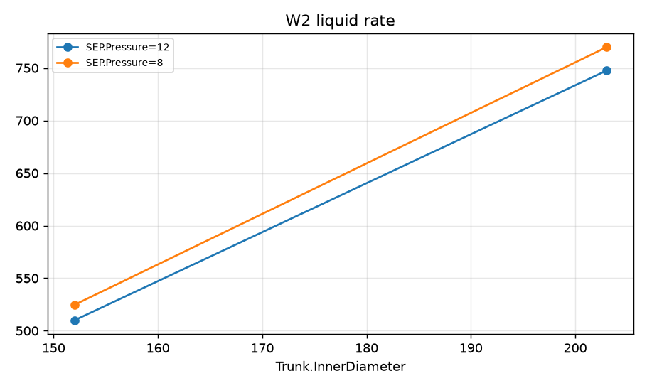
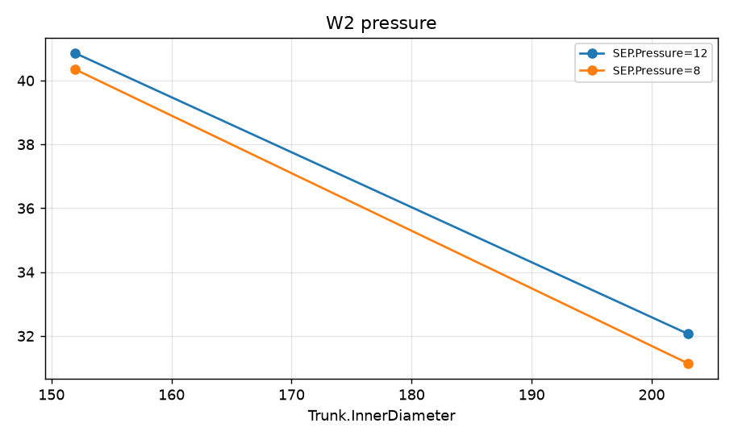
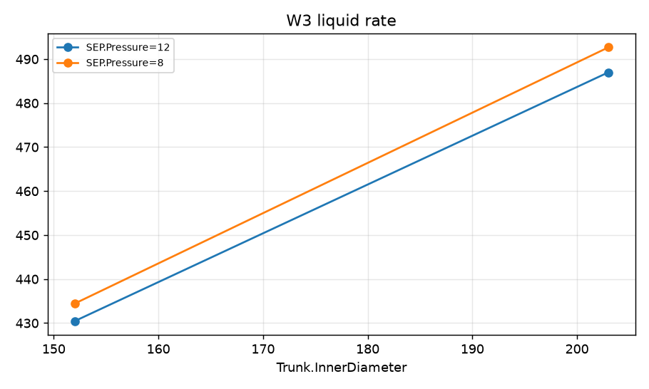
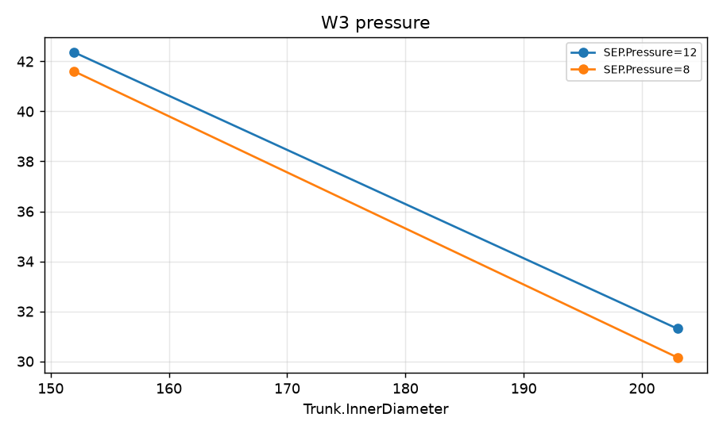

STUDY PLAN: Compare field oil production for four combinations: trunkline ID (152 or 203 mm) and separator pressure (12 or 8 bara)
Units: METRIC
1. Build this network as a new PIPESIM model:
   PROJECT: Field A (METRIC)
     fluid      BO: black oil, 33 API, GOR 120 sm3/sm3, water cut 30 %, gas SG 0.7
     well       W1: reservoir 240 bara / 90 degC, depth 2600 m, tubing 76 mm, PI 9 sm3/d/bar, fluid BO
     well       W2: reservoir 220 bara / 90 degC, depth 2500 m, tubing 76 mm, PI 14 sm3/d/bar, fluid BO
     well       W3: reservoir 210 bara / 90 degC, depth 2450 m, tubing 76 mm, PI 6 sm3/d/bar, fluid BO, gas lift 0.05 mmsm3/d at 2200 m
     junction   M: 
     flowline   FL-W1: W1 -> M, 1000 m, ID 100 mm, elevation +0 m
     flowline   FL-W2: W2 -> M, 1000 m, ID 100 mm, elevation +0 m
     flowline   FL-W3: W3 -> M, 1000 m, ID 100 mm, elevation +0 m
     flowline   Trunk: M -> SEP, 6000 m, ID 152 mm, elevation +15 m
     sink       SEP: 12 bara
2. Analysis: grid (full-factorial combination of 2-3 variables)
     Flowline:Trunk.InnerDiameter: [152, 203]
     Sink:SEP.Pressure: [12, 8]
3. Results recorded: liquid, oil and gas rate at each sink; liquid rate and pressure at each well and source
4. Total simulation runs: 5. Outputs: CSV, charts, report.md in runs/<timestamp>/

## Results

| case | Trunk.InnerDiameter | SEP.Pressure | SEP liquid rate [sm3/d] | SEP oil rate [sm3/d] | SEP gas rate [mmsm3/d] | W1 liquid rate [sm3/d] | W1 pressure [bara] | W2 liquid rate [sm3/d] | W2 pressure [bara] | W3 liquid rate [sm3/d] | W3 pressure [bara] | _status | SEP oil rate change vs base [%] |
|---|---|---|---|---|---|---|---|---|---|---|---|---|---|
| base | 152 | 12 | 1396 | 976.9 | 0.1672 | 454.5 | 40.36 | 509.9 | 40.86 | 430.4 | 42.36 | Completed | 0 |
| Trunk.InnerDiameter=152, SEP.Pressure=12 | 152 | 12 | 1396 | 976.9 | 0.1672 | 454.5 | 40.36 | 509.9 | 40.86 | 430.4 | 42.36 | Completed | 0 |
| Trunk.InnerDiameter=152, SEP.Pressure=8 | 152 | 8 | 1424 | 997.1 | 0.1697 | 465 | 39.82 | 524.7 | 40.35 | 434.4 | 41.6 | Completed | 2.07 |
| Trunk.InnerDiameter=203, SEP.Pressure=12 | 203 | 12 | 1874 | 1312 | 0.2074 | 640.4 | 30.37 | 747.6 | 32.07 | 487 | 31.31 | Completed | 34.27 |
| Trunk.InnerDiameter=203, SEP.Pressure=8 | 203 | 8 | 1920 | 1344 | 0.2112 | 658 | 29.32 | 769.8 | 31.15 | 492.7 | 30.15 | Completed | 37.55 |

