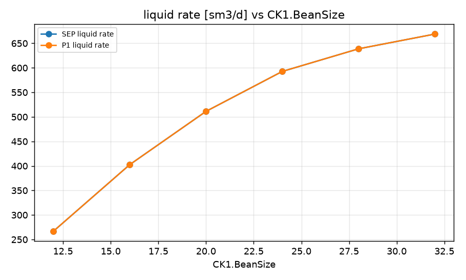
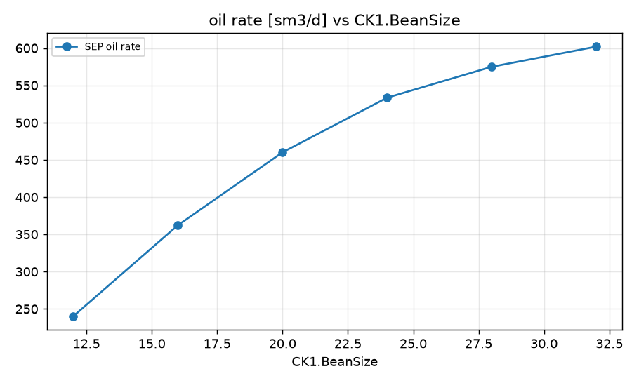
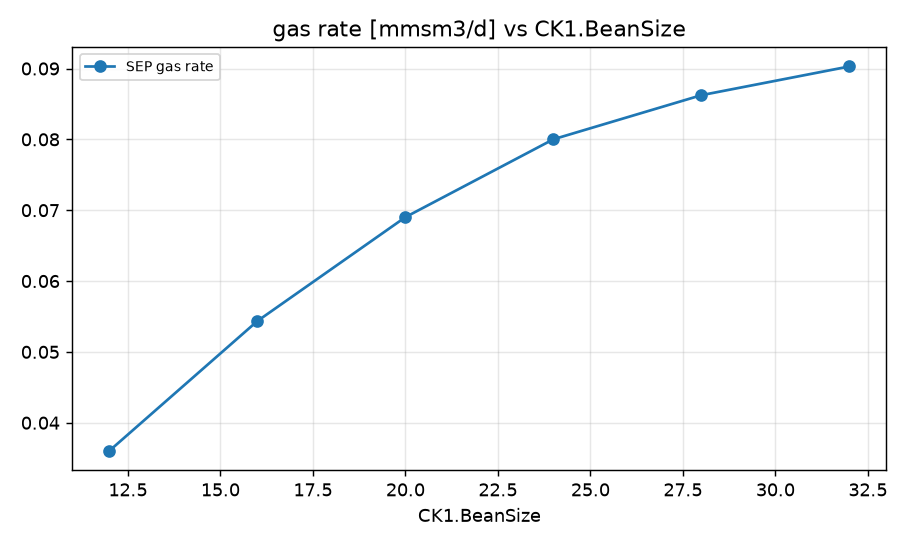
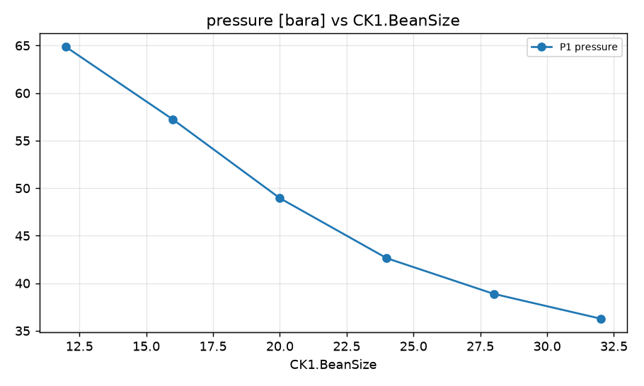

STUDY PLAN: Sweep of CK1.BeanSize
Units: METRIC
1. Build this network as a new PIPESIM model:
   PROJECT: Well Study (METRIC)
     fluid      BO: black oil, 38 API, GOR 150 sm3/sm3, water cut 10 %, gas SG 0.72
     well       P1: reservoir 280 bara / 95 degC, depth 3000 m, tubing 89 mm, PI 6 sm3/d/bar, fluid BO
     choke      CK1: bean 20 mm
     flowline   FL-1: P1 -> CK1, 4000 m, ID 127 mm, elevation +0 m
     flowline   FL-2: CK1 -> SEP, 10 m, ID 127 mm, elevation +0 m
     sink       SEP: 20 bara
2. Analysis: sweep (vary ONE variable over a range, everything else at base)
     Choke:CK1.BeanSize: [12, 16, 20, 24, 28, 32]
3. Results recorded: liquid, oil and gas rate at each sink; liquid rate and pressure at each well and source
4. Total simulation runs: 7. Outputs: CSV, charts, report.md in runs/<timestamp>/

## Results

| case | CK1.BeanSize | SEP liquid rate [sm3/d] | SEP oil rate [sm3/d] | SEP gas rate [mmsm3/d] | P1 liquid rate [sm3/d] | P1 pressure [bara] | _status | SEP oil rate change vs base [%] |
|---|---|---|---|---|---|---|---|---|
| base | 20 | 511.3 | 460.1 | 0.06902 | 511.3 | 48.95 | Completed | 0 |
| CK1.BeanSize=12 | 12 | 267 | 240.3 | 0.03605 | 267 | 64.85 | Completed | -47.77 |
| CK1.BeanSize=16 | 16 | 402.7 | 362.4 | 0.05436 | 402.7 | 57.22 | Completed | -21.24 |
| CK1.BeanSize=20 | 20 | 511.3 | 460.1 | 0.06902 | 511.3 | 48.95 | Completed | 0 |
| CK1.BeanSize=24 | 24 | 592.7 | 533.4 | 0.08001 | 592.7 | 42.63 | Completed | 15.93 |
| CK1.BeanSize=28 | 28 | 638.8 | 574.9 | 0.08624 | 638.8 | 38.89 | Completed | 24.94 |
| CK1.BeanSize=32 | 32 | 668.8 | 602 | 0.09029 | 668.8 | 36.28 | Completed | 30.82 |

