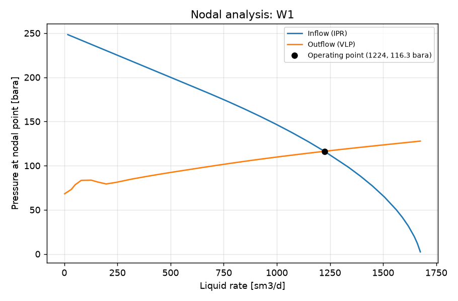

STUDY PLAN: Nodal analysis of W1
Units: METRIC
1. Build this network as a new PIPESIM model:
   PROJECT: Field W1 (METRIC)
     fluid      BO: black oil, 35 API, GOR 100 sm3/sm3, water cut 20 %, gas SG 0.7
     well       W1: reservoir 250 bara / 90 degC, depth 2500 m, tubing 76 mm, PI 10 sm3/d/bar, fluid BO, gas lift 0.05 mmsm3/d at 2000 m
     flowline   FL-W1: W1 -> SEP, 2000 m, ID 100 mm, elevation +0 m
     sink       SEP: 15 bara
2. Analysis: nodal (nodal analysis of one well: inflow (IPR) vs outflow (VLP) curves and the operating point)
     well: W1, outlet pressure: 20 bara
3. Results: operating point (liquid, oil, gas rate; flowing bottom-hole pressure), inflow and outflow curves, nodal plot
4. Total simulation runs: 1. Outputs: CSV, charts, report.md in runs/<timestamp>/

## Results

| case | liquid_rate [sm3/d] | oil_rate [sm3/d] | reservoir_gas_rate [mmsm3/d] | water_rate [sm3/d] | bottomhole_pressure [bara] | outlet_pressure [bara] | _status | curve rate | curve pressure [bara] |
|---|---|---|---|---|---|---|---|---|---|
| operating point | 1224 | 979.1 | 0.09791 | 244.8 | 116.3 | 20 | Completed |  |  |
| inflow_0 |  |  |  |  |  |  |  | 16.75 | 248.3 |
| inflow_0 |  |  |  |  |  |  |  | 54.47 | 244.5 |
| inflow_0 |  |  |  |  |  |  |  | 92.19 | 240.8 |
| inflow_0 |  |  |  |  |  |  |  | 129.9 | 237 |
| inflow_0 |  |  |  |  |  |  |  | 167.6 | 233.2 |
| inflow_0 |  |  |  |  |  |  |  | 205.4 | 229.5 |
| inflow_0 |  |  |  |  |  |  |  | 243.1 | 225.7 |
| inflow_0 |  |  |  |  |  |  |  | 318.5 | 218.1 |
| inflow_0 |  |  |  |  |  |  |  | 394 | 210.6 |
| inflow_0 |  |  |  |  |  |  |  | 469.4 | 203.1 |
| inflow_0 |  |  |  |  |  |  |  | 544.8 | 195.5 |
| inflow_0 |  |  |  |  |  |  |  | 620.3 | 188 |
| inflow_0 |  |  |  |  |  |  |  | 695.7 | 180.4 |
| inflow_0 |  |  |  |  |  |  |  | 771.2 | 172.5 |
| inflow_0 |  |  |  |  |  |  |  | 846.6 | 164.3 |
| inflow_0 |  |  |  |  |  |  |  | 922.1 | 155.7 |
| inflow_0 |  |  |  |  |  |  |  | 997.5 | 146.7 |
| inflow_0 |  |  |  |  |  |  |  | 1073 | 137.2 |
| inflow_0 |  |  |  |  |  |  |  | 1148 | 127.1 |
| inflow_0 |  |  |  |  |  |  |  | 1224 | 116.3 |
| inflow_0 |  |  |  |  |  |  |  | 1337 | 98.28 |
| inflow_0 |  |  |  |  |  |  |  | 1393 | 88.19 |
| inflow_0 |  |  |  |  |  |  |  | 1449 | 77.09 |
| inflow_0 |  |  |  |  |  |  |  | 1506 | 64.6 |
| inflow_0 |  |  |  |  |  |  |  | 1562 | 50.01 |
| inflow_0 |  |  |  |  |  |  |  | 1591 | 41.48 |
| inflow_0 |  |  |  |  |  |  |  | 1619 | 31.65 |
| inflow_0 |  |  |  |  |  |  |  | 1647 | 19.61 |
| inflow_0 |  |  |  |  |  |  |  | 1661 | 12.08 |
| inflow_0 |  |  |  |  |  |  |  | 1675 | 2.417 |
| outflow_0 |  |  |  |  |  |  |  | 1.675 | 68.19 |
| outflow_0 |  |  |  |  |  |  |  | 32.96 | 73.12 |
| outflow_0 |  |  |  |  |  |  |  | 51.73 | 78.5 |
| outflow_0 |  |  |  |  |  |  |  | 79.89 | 83.37 |
| outflow_0 |  |  |  |  |  |  |  | 126.8 | 83.59 |
| outflow_0 |  |  |  |  |  |  |  | 155 | 81.64 |
| outflow_0 |  |  |  |  |  |  |  | 197.2 | 79.27 |
| outflow_0 |  |  |  |  |  |  |  | 244.1 | 81.11 |
| outflow_0 |  |  |  |  |  |  |  | 314.5 | 84.67 |
| outflow_0 |  |  |  |  |  |  |  | 384.9 | 87.73 |
| outflow_0 |  |  |  |  |  |  |  | 427.2 | 89.46 |
| outflow_0 |  |  |  |  |  |  |  | 490.5 | 91.96 |
| outflow_0 |  |  |  |  |  |  |  | 537.5 | 93.72 |
| outflow_0 |  |  |  |  |  |  |  | 607.9 | 96.35 |
| outflow_0 |  |  |  |  |  |  |  | 678.3 | 98.95 |
| outflow_0 |  |  |  |  |  |  |  | 720.5 | 100.5 |
| outflow_0 |  |  |  |  |  |  |  | 783.9 | 102.7 |
| outflow_0 |  |  |  |  |  |  |  | 854.2 | 105.1 |
| outflow_0 |  |  |  |  |  |  |  | 896.5 | 106.5 |
| outflow_0 |  |  |  |  |  |  |  | 959.8 | 108.5 |
| outflow_0 |  |  |  |  |  |  |  | 1002 | 109.8 |
| outflow_0 |  |  |  |  |  |  |  | 1065 | 111.7 |
| outflow_0 |  |  |  |  |  |  |  | 1129 | 113.6 |
| outflow_0 |  |  |  |  |  |  |  | 1224 | 116.3 |
| outflow_0 |  |  |  |  |  |  |  | 1296 | 118.2 |
| outflow_0 |  |  |  |  |  |  |  | 1339 | 119.4 |
| outflow_0 |  |  |  |  |  |  |  | 1404 | 121 |
| outflow_0 |  |  |  |  |  |  |  | 1513 | 123.8 |
| outflow_0 |  |  |  |  |  |  |  | 1578 | 125.4 |

