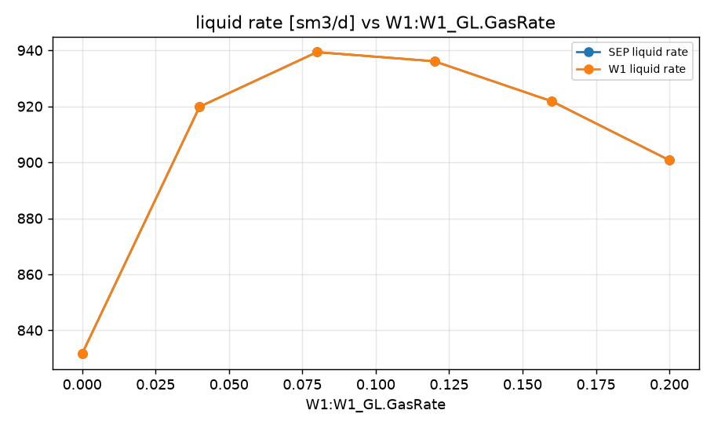
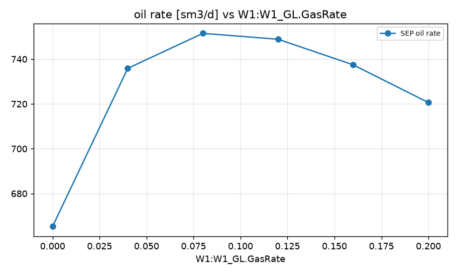
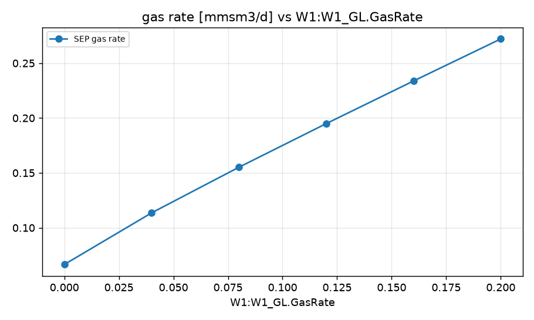
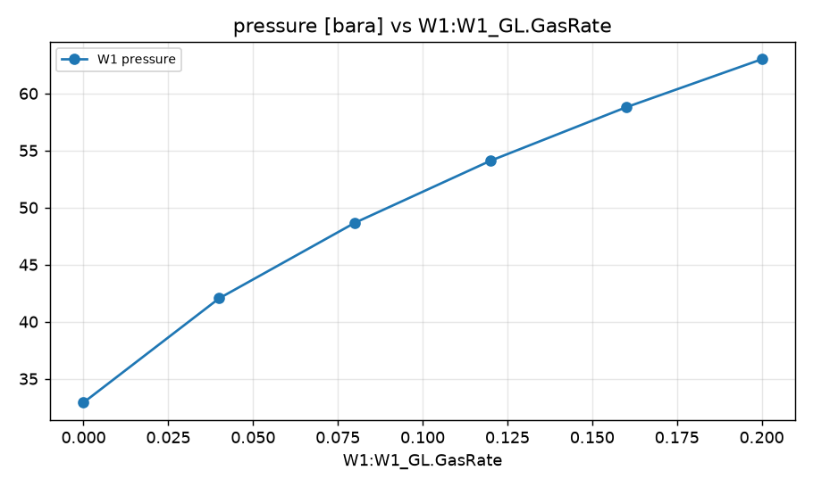

STUDY PLAN: Sweep of W1:W1_GL.GasRate
Units: METRIC
1. Build this network as a new PIPESIM model:
   PROJECT: Field W1 (METRIC)
     fluid      BO: black oil, 35 API, GOR 100 sm3/sm3, water cut 20 %, gas SG 0.7
     well       W1: reservoir 250 bara / 90 degC, depth 2500 m, tubing 76 mm, PI 10 sm3/d/bar, fluid BO, gas lift 0.05 mmsm3/d at 2000 m
     flowline   FL-W1: W1 -> SEP, 2000 m, ID 100 mm, elevation +0 m
     sink       SEP: 15 bara
2. Analysis: sweep (vary ONE variable over a range, everything else at base)
     GasLiftInjection:W1:W1_GL.GasRate: [0, 0.04, 0.08, 0.12, 0.16, 0.2]
3. Results recorded: liquid, oil and gas rate at each sink; liquid rate and pressure at each well and source
4. Total simulation runs: 7. Outputs: CSV, charts, report.md in runs/<timestamp>/

## Results

| case | W1:W1_GL.GasRate | SEP liquid rate [sm3/d] | SEP oil rate [sm3/d] | SEP gas rate [mmsm3/d] | W1 liquid rate [sm3/d] | W1 pressure [bara] | _status | SEP oil rate change vs base [%] |
|---|---|---|---|---|---|---|---|---|
| base | 0.05 | 928.3 | 742.6 | 0.1243 | 928.3 | 43.84 | Completed | 0 |
| W1:W1_GL.GasRate=0 | 0 | 831.6 | 665.3 | 0.06653 | 831.6 | 32.92 | Completed | -10.41 |
| W1:W1_GL.GasRate=0.04 | 0.04 | 919.8 | 735.9 | 0.1136 | 919.8 | 42.05 | Completed | -0.91 |
| W1:W1_GL.GasRate=0.08 | 0.08 | 939.4 | 751.5 | 0.1552 | 939.4 | 48.66 | Completed | 1.2 |
| W1:W1_GL.GasRate=0.12 | 0.12 | 936.1 | 748.9 | 0.1949 | 936.1 | 54.1 | Completed | 0.84 |
| W1:W1_GL.GasRate=0.16 | 0.16 | 921.8 | 737.4 | 0.2337 | 921.8 | 58.79 | Completed | -0.7 |
| W1:W1_GL.GasRate=0.2 | 0.2 | 900.8 | 720.6 | 0.2721 | 900.8 | 63 | Completed | -2.96 |

