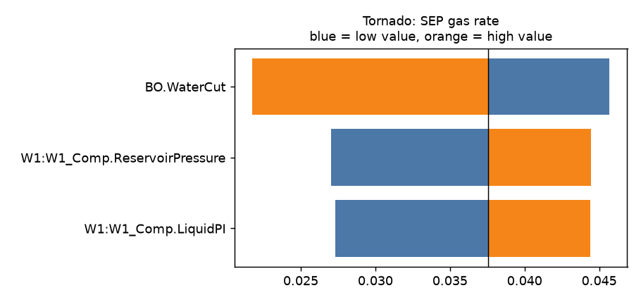
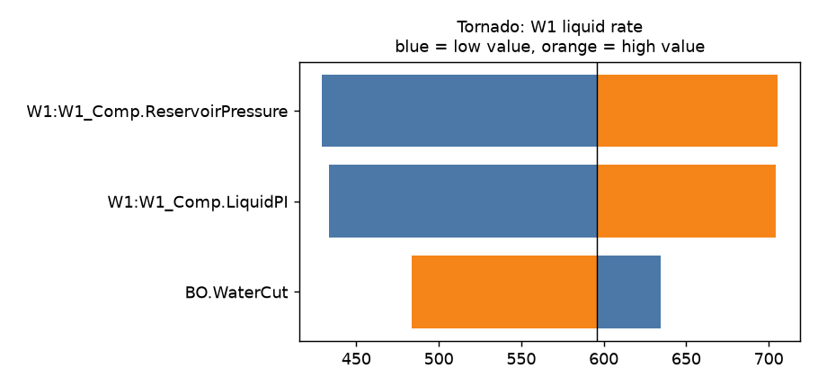
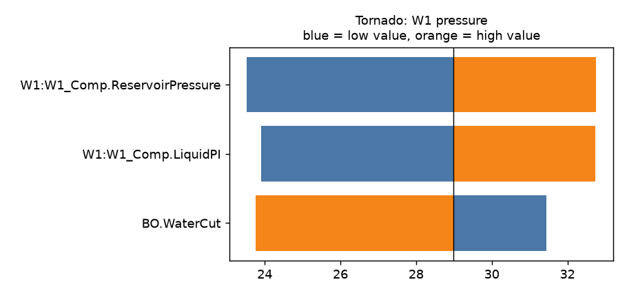

STUDY PLAN: Tornado of W1:W1_Comp.ReservoirPressure, W1:W1_Comp.LiquidPI, BO.WaterCut
Units: METRIC
1. Build this network as a new PIPESIM model:
   PROJECT: Well study (METRIC)
     fluid      BO: black oil, 32 API, GOR 90 sm3/sm3, water cut 30 %, gas SG 0.7
     well       W1: reservoir 230 bara / 85 degC, depth 2400 m, tubing 76 mm, PI 10 sm3/d/bar, fluid BO
     flowline   FL-W1: W1 -> SEP, 3000 m, ID 100 mm, elevation +0 m
     sink       SEP: 15 bara
2. Analysis: tornado (vary each variable to its low and high value one at a time, then rank the impacts)
     Completion:W1:W1_Comp.ReservoirPressure: [200, 250]
     Completion:W1:W1_Comp.LiquidPI: [6, 14]
     BlackOilFluid:BO.WaterCut: [20, 50]
3. Results recorded: liquid, oil and gas rate at each sink; liquid rate and pressure at each well and source
4. Total simulation runs: 7. Outputs: CSV, charts, report.md in runs/<timestamp>/

## Results

| case | W1:W1_Comp.ReservoirPressure | W1:W1_Comp.LiquidPI | BO.WaterCut | SEP liquid rate [sm3/d] | SEP oil rate [sm3/d] | SEP gas rate [mmsm3/d] | W1 liquid rate [sm3/d] | W1 pressure [bara] | _status | SEP oil rate change vs base [%] |
|---|---|---|---|---|---|---|---|---|---|---|
| base | 230 | 10 | 30 | 596 | 417.2 | 0.03755 | 596 | 28.98 | Completed | 0 |
| W1:W1_Comp.ReservoirPressure low=200 | 200 | 10 | 30 | 429.4 | 300.5 | 0.02705 | 429.4 | 23.53 | Completed | -27.96 |
| W1:W1_Comp.ReservoirPressure high=250 | 250 | 10 | 30 | 705.5 | 493.8 | 0.04444 | 705.5 | 32.76 | Completed | 18.36 |
| W1:W1_Comp.LiquidPI low=6 | 230 | 6 | 30 | 433.7 | 303.6 | 0.02733 | 433.7 | 23.91 | Completed | -27.23 |
| W1:W1_Comp.LiquidPI high=14 | 230 | 14 | 30 | 704.5 | 493.2 | 0.04438 | 704.5 | 32.74 | Completed | 18.2 |
| BO.WaterCut low=20 | 230 | 10 | 20 | 634.6 | 507.7 | 0.04569 | 634.6 | 31.44 | Completed | 21.68 |
| BO.WaterCut high=50 | 230 | 10 | 50 | 483.7 | 241.8 | 0.02176 | 483.7 | 23.76 | Completed | -42.04 |

