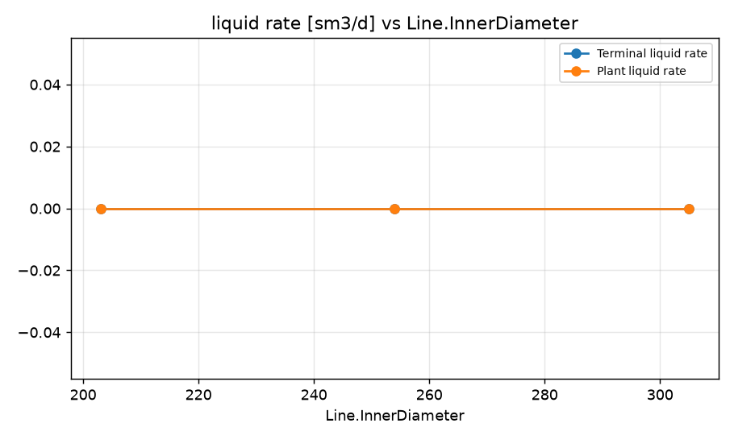
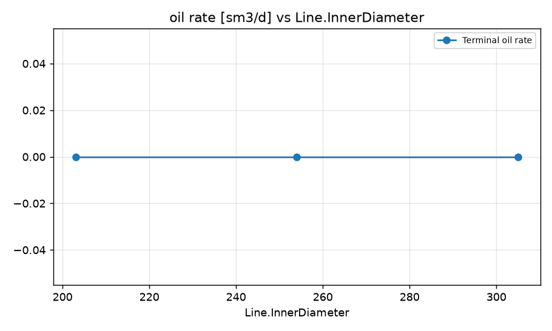
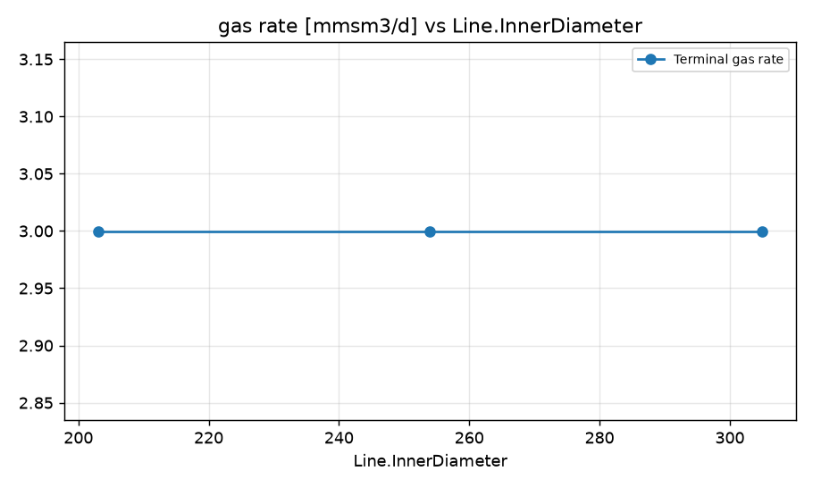
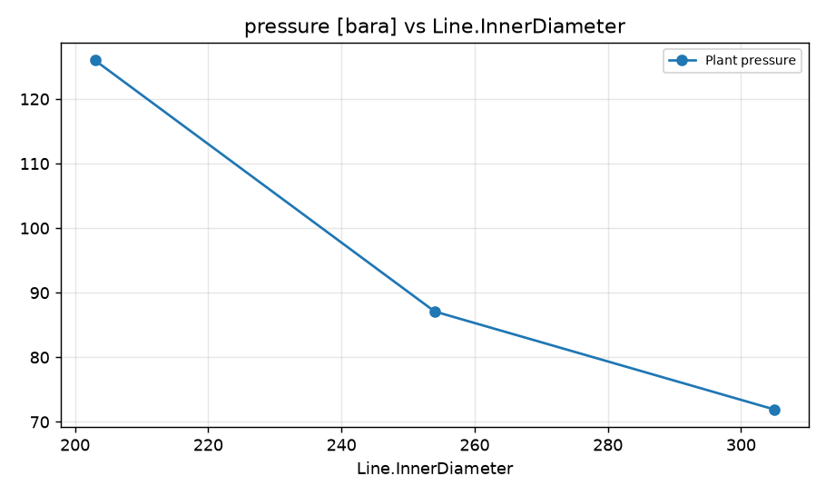

STUDY PLAN: Find smallest diameter that keeps inlet pressure ≤ 90 bara
Units: METRIC
1. Build this network as a new PIPESIM model:
   PROJECT: Gas Export Pipeline (METRIC)
     fluid      Gas: gas, SG 0.62, OGR 0 sm3/mmsm3, WGR 0 sm3/mmsm3
     source     Plant: gas rate 3 mmsm3/d, 40 degC, fluid Gas
     flowline   Line: Plant -> Terminal, 25000 m, ID 203 mm, elevation +0 m
     sink       Terminal: 60 bara
2. Analysis: sweep (vary ONE variable over a range, everything else at base)
     Flowline:Line.InnerDiameter: [203, 254, 305]
3. Results recorded: liquid, oil and gas rate at each sink; liquid rate and pressure at each well and source
4. Total simulation runs: 4. Outputs: CSV, charts, report.md in runs/<timestamp>/

## Results

| case | Line.InnerDiameter | Terminal liquid rate [sm3/d] | Terminal oil rate [sm3/d] | Terminal gas rate [mmsm3/d] | Plant liquid rate [sm3/d] | Plant pressure [bara] | _status |
|---|---|---|---|---|---|---|---|
| base | 203 | 0 | 0 | 3 | 0 | 126 | Completed |
| Line.InnerDiameter=203 | 203 | 0 | 0 | 3 | 0 | 126 | Completed |
| Line.InnerDiameter=254 | 254 | 0 | 0 | 3 | 0 | 87.09 | Completed |
| Line.InnerDiameter=305 | 305 | 0 | 0 | 3 | 0 | 71.92 | Completed |

