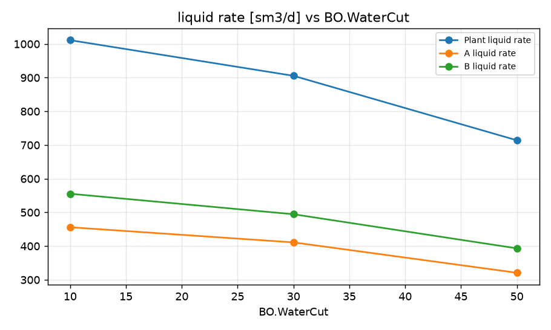
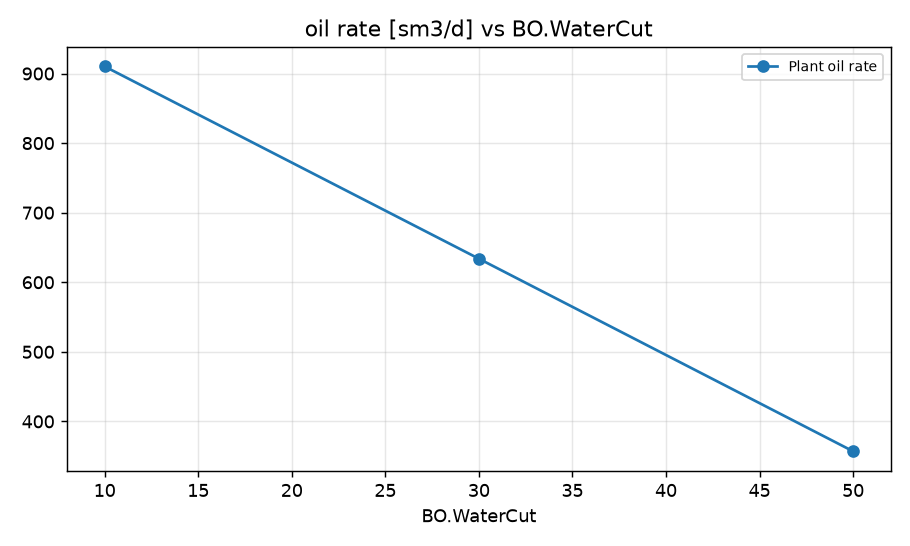
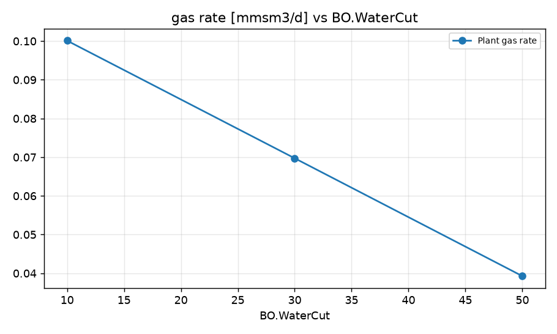
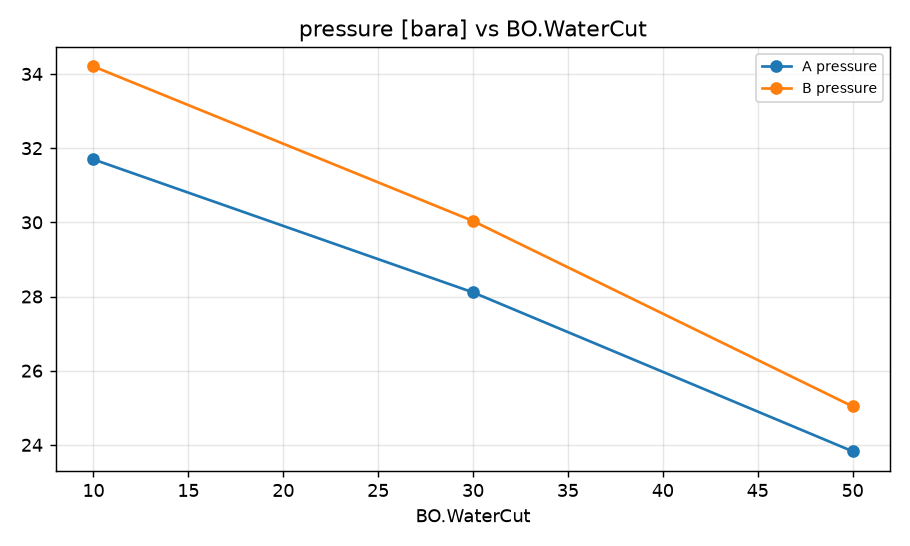

STUDY PLAN: Sweep of BO.WaterCut
Units: METRIC
1. Build this network as a new PIPESIM model:
   PROJECT: Field A (METRIC)
     fluid      BO: black oil, 31 API, GOR 110 sm3/sm3, water cut 30 %, gas SG 0.7
     well       A: reservoir 210 bara / 90 degC, depth 2300 m, tubing 76 mm, PI 7 sm3/d/bar, fluid BO
     well       B: reservoir 190 bara / 90 degC, depth 2200 m, tubing 76 mm, PI 11 sm3/d/bar, fluid BO
     junction   Hub: 
     flowline   FL-A: A -> Hub, 2000 m, ID 100 mm, elevation +0 m
     flowline   FL-B: B -> Hub, 2000 m, ID 100 mm, elevation +0 m
     flowline   Export: Hub -> Plant, 3000 m, ID 152 mm, elevation +0 m
     sink       Plant: 18 bara
2. Analysis: sweep (vary ONE variable over a range, everything else at base)
     BlackOilFluid:BO.WaterCut: [10, 30, 50, 70]
3. Results recorded: liquid, oil and gas rate at each sink; liquid rate and pressure at each well and source
4. Total simulation runs: 5. Outputs: CSV, charts, report.md in runs/<timestamp>/

## Results

| case | BO.WaterCut | Plant liquid rate [sm3/d] | Plant oil rate [sm3/d] | Plant gas rate [mmsm3/d] | A liquid rate [sm3/d] | A pressure [bara] | B liquid rate [sm3/d] | B pressure [bara] | _status | Plant oil rate change vs base [%] |
|---|---|---|---|---|---|---|---|---|---|---|
| base | 30 | 905.5 | 633.9 | 0.06972 | 411 | 28.11 | 494.5 | 30.04 | Completed | 0 |
| BO.WaterCut=10 | 10 | 1011 | 910.2 | 0.1001 | 455.9 | 31.7 | 555.4 | 34.2 | Completed | 43.59 |
| BO.WaterCut=30 | 30 | 905.5 | 633.9 | 0.06972 | 411 | 28.11 | 494.5 | 30.04 | Completed | 0 |
| BO.WaterCut=50 | 50 | 714.1 | 357.1 | 0.03928 | 320.8 | 23.83 | 393.3 | 25.04 | Completed | -43.67 |
| BO.WaterCut=70 | 70 |  |  |  |  |  |  |  | Completed: no results - the system may not flow at these conditions |  |

