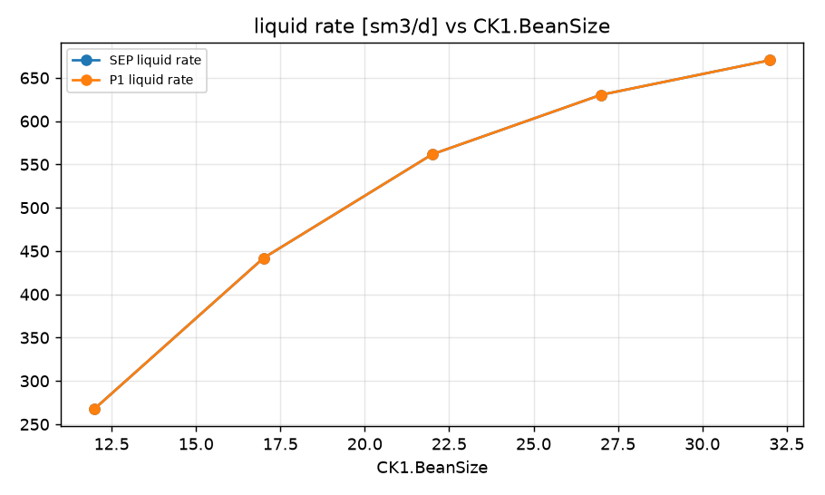
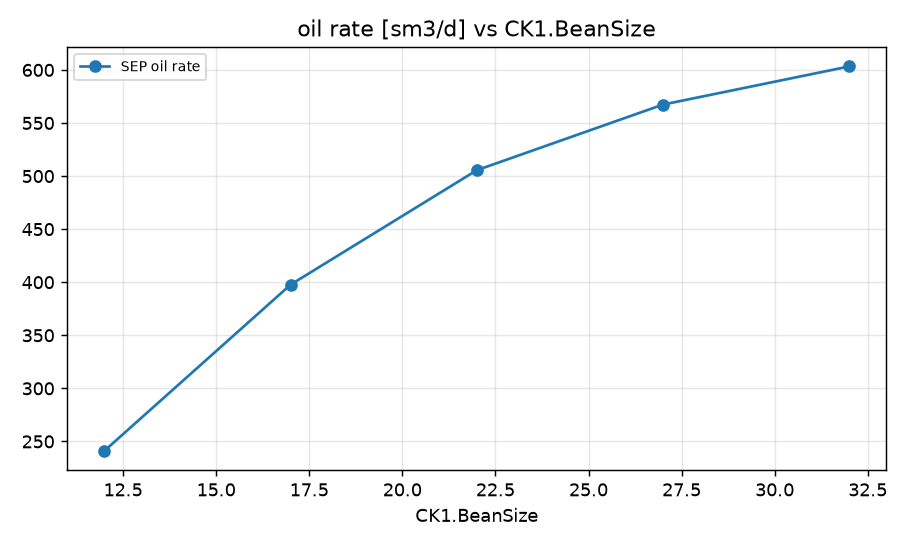
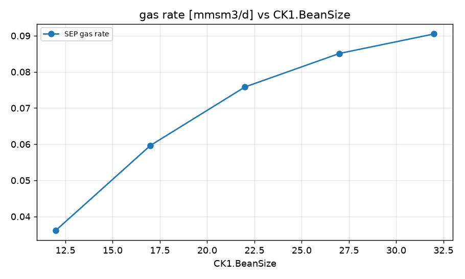
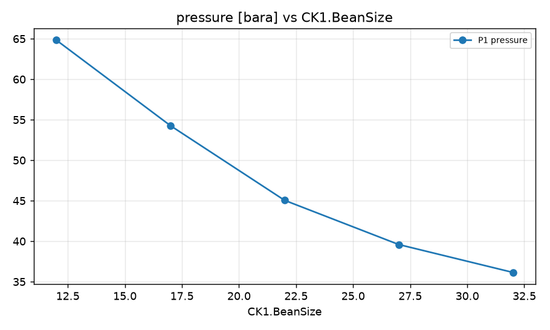

STUDY PLAN: Sweep of CK1.BeanSize
Units: METRIC
1. Build this network as a new PIPESIM model:
   PROJECT: Well study (METRIC)
     fluid      BO: black oil, 38 API, GOR 150 sm3/sm3, water cut 10 %, gas SG 0.72
     well       P1: reservoir 280 bara / 95 degC, depth 3000 m, tubing 89 mm, PI 6 sm3/d/bar, fluid BO
     choke      CK1: bean 20 mm, right after P1
     flowline   FL-P1: CK1 -> SEP, 4000 m, ID 127 mm, elevation +0 m
     sink       SEP: 20 bara
2. Analysis: sweep (vary ONE variable over a range, everything else at base)
     Choke:CK1.BeanSize: [12.0, 17.0, 22.0, 27.0, 32.0]
3. Results recorded: liquid, oil and gas rate at each sink; liquid rate and pressure at each well and source
4. Total simulation runs: 6. Outputs: CSV, charts, report.md in runs/<timestamp>/

## Results

| case | CK1.BeanSize | SEP liquid rate [sm3/d] | SEP oil rate [sm3/d] | SEP gas rate [mmsm3/d] | P1 liquid rate [sm3/d] | P1 pressure [bara] | _status | SEP oil rate change vs base [%] |
|---|---|---|---|---|---|---|---|---|
| base | 20 | 522.8 | 470.6 | 0.07058 | 522.8 | 48.06 | Completed | 0 |
| CK1.BeanSize=12.0 | 12 | 268 | 241.2 | 0.03619 | 268 | 64.83 | Completed | -48.73 |
| CK1.BeanSize=17.0 | 17 | 441.9 | 397.7 | 0.05966 | 441.9 | 54.26 | Completed | -15.48 |
| CK1.BeanSize=22.0 | 22 | 561.7 | 505.5 | 0.07583 | 561.7 | 45.05 | Completed | 7.44 |
| CK1.BeanSize=27.0 | 27 | 630.4 | 567.4 | 0.0851 | 630.4 | 39.59 | Completed | 20.57 |
| CK1.BeanSize=32.0 | 32 | 670.3 | 603.3 | 0.09049 | 670.3 | 36.15 | Completed | 28.21 |

